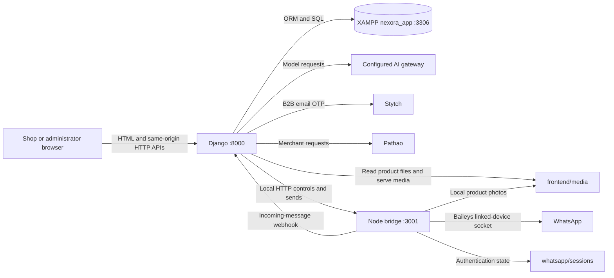
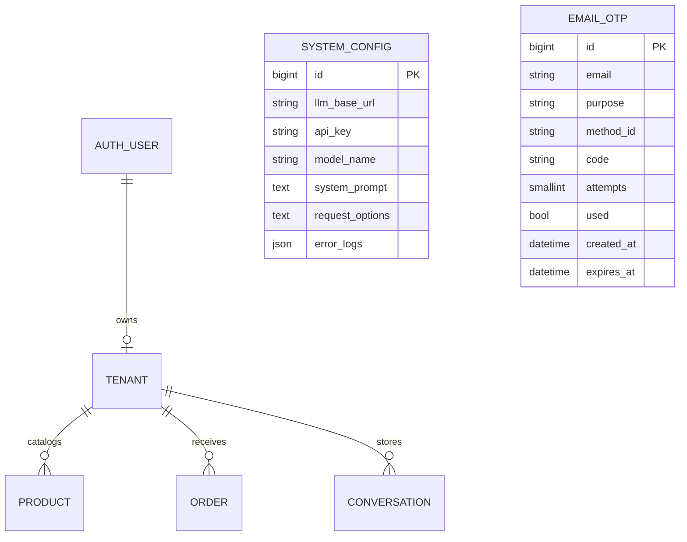
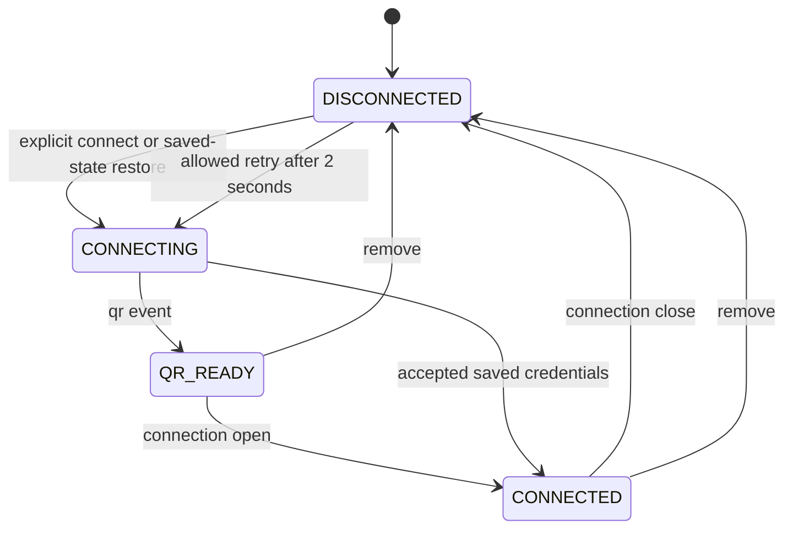
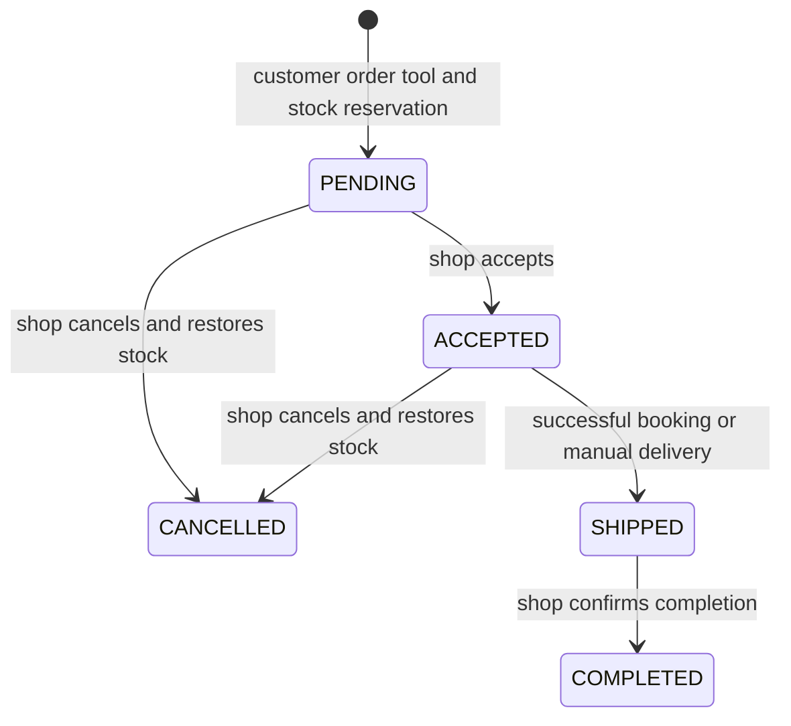

# Nexora: Technical Reference, File Guide, and Reconstruction Blueprint

**Reference date:** 7 November 2026.  
**Project inspected:** `D:\final nexora`.  
**Audience:** the project owner, university assessors, future developers, researchers, and LLMs implementing a close reconstruction.  
**Application:** a small, multi-business WhatsApp sales assistant with a Django website, a Node.js WhatsApp bridge, and a XAMPP MySQL/MariaDB database.

## Contents

1. [Purpose, scope, and how to use this reference](#1-purpose-scope-and-how-to-use-this-reference)
2. [System architecture and the reasons for its shape](#2-system-architecture-and-the-reasons-for-its-shape)
3. [Complete application file and folder map](#3-complete-application-file-and-folder-map)
4. [Startup, dependencies, and configuration](#4-startup-dependencies-and-configuration)
5. [Database schema and JSON contracts](#5-database-schema-and-json-contracts)
6. [Backend file-by-file and function-by-function guide](#6-backend-file-by-file-and-function-by-function-guide)
7. [Website routes and API contracts](#7-website-routes-and-api-contracts)
8. [Authentication and account lifecycles](#8-authentication-and-account-lifecycles)
9. [AI agent, tools, memory, and provider protocols](#9-ai-agent-tools-memory-and-provider-protocols)
10. [WhatsApp bridge and connection lifecycle](#10-whatsapp-bridge-and-connection-lifecycle)
11. [Products, stock, images, orders, and shipping](#11-products-stock-images-orders-and-shipping)
12. [Frontend pages and JavaScript behavior](#12-frontend-pages-and-javascript-behavior)
13. [Visual design and close UI reconstruction](#13-visual-design-and-close-ui-reconstruction)
14. [Demo data, tests, and verification boundaries](#14-demo-data-tests-and-verification-boundaries)
15. [Operations, troubleshooting, and data preservation](#15-operations-troubleshooting-and-data-preservation)
16. [Known limitations and future research](#16-known-limitations-and-future-research)
17. [Ordered implementation blueprint](#17-ordered-implementation-blueprint)
18. [Reconstruction acceptance checklist](#18-reconstruction-acceptance-checklist)
19. [Sources and attribution](#19-sources-and-attribution)

## 1. Purpose, scope, and how to use this reference

### 1.1 What the project actually does

Nexora lets a shop connect a WhatsApp linked device, maintain a product catalog, answer customer messages through an AI model, reserve stock when a customer requests an order, and review that order in a website. A human shop operator accepts or cancels pending orders. Shipping is a separate action: it either books a Pathao parcel or records delivery arranged manually by the shop. A shipped order can then be marked complete.

An administrator manages business accounts, plans, activation, the shared AI provider configuration, and an error log. A shop user sees only its own business dashboard and records through the ordinary tenant-scoped APIs.

The application is a university/small-shop proof of concept. It is not a payment processor, a full warehouse system, an official WhatsApp Business Cloud API implementation, or a hardened public SaaS platform.

### 1.2 What “every file” means here

This reference individually accounts for the **project-owned application files**: Python modules, all seven core migrations, JavaScript, CSS, HTML templates, font assets, the favicon, dependency manifests, launchers, database setup SQL, the README, private configuration-file roles, and this report.

It also accounts for **generated trees**: `.venv`, `node_modules`, Python caches, product uploads, WhatsApp authentication files, and the documentation working notes under `.planning`.

Thousands of installed third-party package files are not individually rewritten here. They are reproduced by installing the dependencies, not by implementing their internals as Nexora code. Likewise, every generated WhatsApp credential/pre-key/session filename is explained by its file family rather than publishing private authentication identifiers and values. This distinction is necessary for both reproducibility and privacy.

### 1.3 What is deliberately absent

- Real API keys, Stytch secrets, merchant passwords, Django session cookies, and WhatsApp private keys.
- The contents of `backend/.env` and `email-auth.md`.
- Live customer messages, addresses, phone numbers, password hashes, and database exports.
- The actual bytes of uploaded product images or installed libraries.
- A guarantee of byte-identical reconstruction, identical AI wording, or permanent compatibility with an external service.

A new implementation must obtain fresh service credentials and fresh WhatsApp linking state. It can closely reproduce the application from these contracts and design details without copying private state.

### 1.4 Facts, rationale, and research are different

**Current behavior** in this document comes from the inspected source. **Rationale** explains why the present arrangement fits the owner's small-project goals; it is not an invented account of undocumented historical decisions. **Research recommendations** are explicitly separated from implemented behavior.

For an existing checkout, source code is the final authority when it differs from this dated reference. For a reconstruction, implement the documented contracts first, then make deliberate decisions about the limitations in Section 16. Do not silently claim that a proposed improvement already exists.

### 1.5 Suggested reading paths

- **Understand the project:** Sections 2, 3, 5, and 11.
- **Rebuild backend behavior:** Sections 4–11 and 17.
- **Reproduce the website:** Sections 12–13, then the DOM contracts in Section 18.
- **Investigate an incident:** Sections 9–11, 15, and 16.
- **Prepare university research:** architecture rationale, data/transaction trade-offs, provider boundaries, and the research questions in Section 16.

## 2. System architecture and the reasons for its shape

### 2.1 The three main responsibilities

| Responsibility | Implementation | Why this arrangement is used |
|---|---|---|
| Website and business rules | Django in `backend/` | Django supplies routing, templates, login sessions, ORM, transactions, and migrations. The custom code can focus on sales behavior. |
| Browser presentation | HTML/CSS/vanilla JS in `frontend/` | No separate frontend server, framework, build pipeline, or deployment artifact is required. |
| Record storage | XAMPP MySQL/MariaDB; creation SQL in `database/` | Familiar local database tooling and phpMyAdmin fit the project workflow. Actual records live in the database server, not in the SQL setup file. |
| WhatsApp transport | Node.js/Baileys inside `backend/whatsapp/` | Baileys handles the WhatsApp Web protocol, linked-device authentication, encryption state, and media transport. Django communicates with a small local HTTP bridge. |

Although there are three top-level application folders, there are **two application processes plus a database server**. `frontend/` is not a third server.

### 2.2 Runtime addresses

| Service | Default address | Purpose |
|---|---|---|
| Django development server | `http://127.0.0.1:8000` | Public landing page, auth pages, dashboards, Django APIs, development static/media serving. |
| Node bridge | `http://127.0.0.1:3001` | Local WhatsApp status/connect/send/reset/remove endpoints. |
| XAMPP MySQL/MariaDB | `127.0.0.1:3306` | Persistent Django tables in `nexora_app`. |
| XAMPP Apache/phpMyAdmin | commonly `http://localhost/phpmyadmin/` | Optional human database administration. Not the Nexora web application. |
| AI provider | administrator-configured HTTPS base URL | Model listing and model inference. |
| Stytch | `https://test.stytch.com` or `https://api.stytch.com` | B2B email OTP sending/authentication. |
| Pathao sandbox | `https://courier-api-sandbox.pathao.com` | Testing merchant authentication and parcel booking. |
| Pathao production | `https://api-hermes.pathao.com` | Real merchant API operations. |

Apache is needed to use phpMyAdmin in the usual XAMPP arrangement; it is not needed for Django to talk directly to MariaDB.

### 2.3 Connection diagram



The browser does not call Node directly in the current implementation. The authenticated Django proxy determines the requesting user's business ID.

### 2.4 Principal actors and boundaries

1. **Anonymous visitor:** landing page, signup, password login, email verification, and password reset.
2. **Shop account:** a Django `User` linked one-to-one to a `Tenant`; manages its catalog, orders, settings, and chat history.
3. **System administrator:** `User.is_staff`; sees administrator widgets and management APIs.
4. **Customer on WhatsApp:** identified by a normalized phone/JID in a business's conversations and orders. This customer is not a Django login account.
5. **AI model:** returns text and named function calls; Python decides which tool implementations can run.
6. **External providers:** independent systems that may reject credentials, time out, rate-limit, or return malformed/unexpected data.

The word **tenant** means “business/shop account,” not a hosting process or separate physical database. All businesses share tables, and tenant foreign keys partition their records.

### 2.5 Design rationale and trade-offs

| Decision | Benefit | Cost or limitation |
|---|---|---|
| One Django app with six main modules | Easy to explain and navigate; fewer tiny helper files. | `views.py` and `app.js` remain large. |
| Django templates plus vanilla JS | No frontend dependency installation/build step. | UI state and rendering are manually coordinated. |
| SKU arrays inside Product JSON | Product editing and variants fit one record/form. | No SQL SKU uniqueness or per-SKU atomic stock constraint. |
| Conversation messages as bounded JSON | Straightforward chat history retrieval and model context. | Rewrites an array; no per-message audit/retention table. |
| Images on disk with database URLs | Small database and ordinary browser/WhatsApp image use. | Database backup alone is insufficient; reference cleanup requires care. |
| One shared SystemConfig | One administrator controls the model provider for all shops. | No per-shop provider or independent cost policy. |
| One real courier, Pathao | Keeps a usable integration without provider-selection branches. | Stores needing another courier must extend the system deliberately. |
| One live email provider, Stytch B2B | Reduces authentication delivery branches and ambiguous fallback. | Requires an organization and correct Stytch settings. |
| Explicit WhatsApp connect and ordered controls | Status requests remain read-only; deletion/reset races are guarded. | The Node process is still stateful and local. |
| Optional, non-destructive demo command | Demonstrations do not reset existing user work. | Existing usernames are skipped rather than reconciled with changed fixtures. |
| Simple XAMPP compatibility subclass | Current application works with the inspected MariaDB 10.4 installation. | This is a compatibility exception, not an upstream Django support guarantee. |

## 3. Complete application file and folder map

### 3.1 Source and supporting tree

```text
final nexora/
├── .gitignore
├── README.md
├── NEXORA_TECHNICAL_REFERENCE.md
├── email-auth.md                       private credential note; not executable
├── start.bat
├── start.sh
├── start_mac.command
├── backend/
│   ├── .env                            private process configuration
│   ├── .env.example
│   ├── requirements.txt
│   ├── manage.py
│   ├── seed_demo.py
│   ├── smoke_test.py
│   ├── .venv/                          generated Python environment
│   ├── core/
│   │   ├── __init__.py
│   │   ├── apps.py
│   │   ├── models.py
│   │   ├── views.py
│   │   ├── agent.py
│   │   ├── email_auth.py
│   │   ├── couriers.py
│   │   ├── widgets.py
│   │   ├── __pycache__/                generated when normal Python imports run
│   │   └── migrations/
│   │       ├── __init__.py
│   │       ├── 0001_initial.py
│   │       ├── 0002_tenant_plan.py
│   │       ├── 0003_order_shipment_tenant_settings_alter_order_status.py
│   │       ├── 0004_tenant_plan_status.py
│   │       ├── 0005_emailotp.py
│   │       ├── 0006_product_is_active.py
│   │       ├── 0007_systemconfig_request_options.py
│   │       └── __pycache__/            generated bytecode
│   ├── nexora/
│   │   ├── __init__.py
│   │   ├── settings.py
│   │   ├── urls.py
│   │   ├── wsgi.py
│   │   └── __pycache__/                generated bytecode
│   └── whatsapp/
│       ├── index.js
│       ├── test.js
│       ├── package.json
│       ├── package-lock.json
│       ├── node_modules/              generated installed packages
│       └── sessions/
│           └── <tenant-id>/           generated private WhatsApp JSON state
├── frontend/
│   ├── templates/
│   │   ├── landing.html
│   │   ├── auth.html
│   │   ├── client.html
│   │   ├── admin.html
│   │   └── 404.html
│   ├── static/
│   │   ├── app.js
│   │   ├── charts.js
│   │   ├── style.css
│   │   ├── favicon.svg
│   │   └── fonts/
│   │       ├── geist-latin.woff2
│   │       ├── geist-mono-latin.woff2
│   │       ├── instrument-serif-latin.woff2
│   │       └── OFL.txt
│   └── media/
│       └── <tenant-id>/<uuid>.<extension>
├── database/
│   └── setup.sql
└── .planning/                          optional agent documentation working notes
    ├── .active_plan
    └── 2026-11-07-nexora-reference-report/
        ├── task_plan.md
        ├── findings.md
        ├── progress.md
        └── source-inventory.json
```

The tree intentionally uses placeholders for private/generated filenames. A fresh installation creates only the runtime folders/files it actually needs. There is no active `database/db.sqlite3` in this installation after the XAMPP migration.

### 3.2 Root files

| File | What it does | Why it exists and how it integrates |
|---|---|---|
| `.gitignore` | Excludes `node_modules/`, WhatsApp sessions, uploads, Python caches, `.venv/`, `.env`, the private email note, SQLite files and selected backup patterns. | Separates reproducible source from secrets/runtime data. It does not delete those files or protect a public web server. |
| `README.md` | Quick start, folder orientation, feature configuration, order explanation, test commands and dependency credits. | Human entry point; deliberately shorter than this reference. |
| `NEXORA_TECHNICAL_REFERENCE.md` | This technical specification and research handoff. | Describes current implementation and close reconstruction without embedding private state. No runtime imports it. |
| `email-auth.md` | User-maintained Stytch credential/reference note. | Kept privately for setup. Django does **not** parse this Markdown file. Required values must be configured separately in `backend/.env` or the environment. |
| `start.bat` | Windows setup/start launcher. | Resolves paths relative to itself, applies migrations and opens Node/Django server windows. Detailed lifecycle in Section 4. |
| `start.sh` | macOS/Linux Bash setup/start launcher. | Uses OS-native virtualenv paths, starts both processes, and traps exit/signals to stop them. |
| `start_mac.command` | Three-line macOS wrapper. | Resolves its directory and `exec bash` runs `start.sh`, forwarding arguments. It avoids a second startup implementation. |

### 3.3 Backend supporting files

| File/folder | Role | Integration |
|---|---|---|
| `backend/` | Server-side application root. | `manage.py`, the settings package, business package and WhatsApp transport live here. |
| `backend/.env` | Private key/value configuration. | Read by `nexora/settings.py`; not a Python module and not automatically read by Node. |
| `backend/.env.example` | Safe setup template. | Copied only if `.env` is missing; documents MySQL, AI defaults, Stytch, encoding and proxy variables. |
| `backend/requirements.txt` | Python dependency ranges. | `pip install -r` installs Django, PyMySQL and Requests plus their dependencies. |
| `backend/manage.py` | Django CLI entry point. | `main()` sets `DJANGO_SETTINGS_MODULE=nexora.settings`, then passes CLI arguments to Django. |
| `backend/seed_demo.py` | Optional synthetic sample data. | Initializes Django and creates absent demo usernames under a transaction; not part of normal startup. |
| `backend/smoke_test.py` | Script-style regression suite. | Initializes isolated SQLite or temporary MySQL storage, temporary uploads and mocked external requests. |
| `backend/.venv/` | Local Python interpreter/dependency environment. | Launchers use its executable directly; activation is unnecessary. Not portable across operating systems. |

### 3.4 Django packages and all migrations

| File | Purpose and connection |
|---|---|
| `backend/core/__init__.py` | Empty Python package marker. No bootstrap side effects. |
| `backend/core/apps.py` | `CoreConfig`: `name="core"`, default auto-field `django.db.models.BigAutoField`. Django discovers this app configuration. |
| `backend/core/models.py` | All six custom models, plan limits, stock lookup/update and reference-aware image helpers. Used throughout core code. |
| `backend/core/views.py` | HTML/account flows, authenticated website APIs, webhook intake, order/catalog management and administrator APIs. URL handlers are mapped in `urls.py`. |
| `backend/core/agent.py` | AI prompt, five tool schemas/implementations, provider requests, command bypass, chat memory and usage updates. Called by the incoming WhatsApp webhook. |
| `backend/core/email_auth.py` | Password policy, OTP creation, Stytch B2B delivery/authentication and explicit dev mode. Used by signup/reset/account/admin-create views. |
| `backend/core/couriers.py` | Pathao authentication/store discovery/booking and manual shipment metadata. Called by shipping and connection-test views. |
| `backend/core/widgets.py` | Role-specific dashboard data builders and derived catalog/sales metrics. Requested by `api_dashboard`; rendered by `app.js`. |
| `backend/core/migrations/__init__.py` | Empty package marker enabling migration discovery. |
| `backend/core/migrations/0001_initial.py` | Initial schema for SystemConfig, Tenant, Product, Order and Conversation. Depends on Django's swappable auth user model. Initially lacks later plan/shipment/archive/options fields. |
| `backend/core/migrations/0002_tenant_plan.py` | Adds Tenant.plan with BASIC/PLUS/PRO choices; depends on 0001. |
| `backend/core/migrations/0003_order_shipment_tenant_settings_alter_order_status.py` | Adds Order.shipment and Tenant.settings JSON; adds SHIPPED to Order.status choices; depends on 0002. |
| `backend/core/migrations/0004_tenant_plan_status.py` | Adds Tenant.plan_status with ACTIVE/CANCELLED; depends on 0003. |
| `backend/core/migrations/0005_emailotp.py` | Creates EmailOTP and its email/purpose/method/code/attempt/used/time fields; depends on 0004. |
| `backend/core/migrations/0006_product_is_active.py` | Adds Product.is_active for archiving; depends on 0005. |
| `backend/core/migrations/0007_systemconfig_request_options.py` | Adds SystemConfig.request_options text containing JSON; depends on 0006. |
| `backend/nexora/__init__.py` | Empty Django settings-package marker. |
| `backend/nexora/settings.py` | Filesystem paths, installed apps, middleware, templates, database adapter/configuration, locale, assets, bridge URL and Stytch settings. |
| `backend/nexora/urls.py` | Project route table, including Django admin and DEBUG-only static/media URL additions. |
| `backend/nexora/wsgi.py` | Sets settings module and exports `application=get_wsgi_application()` for WSGI integration. No custom ASGI application is present. |

Migration files are **schema history**, not live records or cached output. An existing installation needs the original migration sequence so Django can determine which operations have been applied. A brand-new reconstruction may generate an equivalent schema from equivalent models, but should retain these names/operations when compatibility with an existing Nexora database matters.

### 3.5 WhatsApp files

| File/folder | Purpose | Why it is separate |
|---|---|---|
| `backend/whatsapp/index.js` | Entire Express/Baileys bridge, media resolution, inbound webhook forwarding, session lifecycle and HTTP controls. | JavaScript WhatsApp transport stays separate from Python business rules. |
| `backend/whatsapp/test.js` | Eight Node built-in regression cases with fake sockets and disposable directories. | Tests lifecycle races without connecting to WhatsApp or adding a testing dependency. |
| `backend/whatsapp/package.json` | Package identity, scripts and direct dependency ranges. | Defines the bridge install/run/test contract. |
| `backend/whatsapp/package-lock.json` | Resolved npm dependency graph, integrity and versions. | `npm ci` reproduces the locked graph rather than resolving fresh ranges. |
| `backend/whatsapp/node_modules/` | Installed direct/transitive libraries. | Generated from the manifests; never reimplement all its files as project code. |
| `backend/whatsapp/sessions/` | Per-business private Baileys state. | Persists linked-device authentication across process restarts. |

### 3.6 Frontend files and assets

| File/folder | Purpose and integration |
|---|---|
| `frontend/` | Shared presentation root used by settings and the bridge's media resolver. |
| `frontend/templates/landing.html` | Anonymous marketing/product overview page; includes independent inline reveal/typing/demo-chat animations. |
| `frontend/templates/auth.html` | One complete document branching on `screen`: login, signup, reset request, or verification; reset verification adds new-password/confirm fields. |
| `frontend/templates/client.html` | Shop dashboard markup, seven tabs, data-widget placeholders, product/assistant/profile/Pathao forms and cancel/account/order drawers. |
| `frontend/templates/admin.html` | Staff dashboard markup, three tabs, AI provider/business forms and account/tenant drawers. |
| `frontend/templates/404.html` | Ordinary Django 404 template with home/login links; DEBUG may show Django's technical 404 instead. |
| `frontend/static/app.js` | Dashboard rendering, caches, API wrapper, action delegation, form wiring, drawers, catalog tools and WhatsApp polling. |
| `frontend/static/charts.js` | SVG donut and DOM bar chart functions exported as `window.NexoraCharts`; loaded before app.js on the client dashboard. |
| `frontend/static/style.css` | Shared fonts, light/dark design tokens, layout, controls, tables, charts, landing styles, forms, drawers and responsive rules. |
| `frontend/static/favicon.svg` | A 32×32 black rounded square and off-white stroked N. Loaded by all page templates. |
| `frontend/static/fonts/geist-latin.woff2` | Local sans-serif body/control font; Geist weights 400–700, `font-display:swap`. |
| `frontend/static/fonts/geist-mono-latin.woff2` | Local monospaced SKU/phone/code/log font; weights 400–600. |
| `frontend/static/fonts/instrument-serif-latin.woff2` | Local serif brand/heading/large-number font; weight 400. |
| `frontend/static/fonts/OFL.txt` | Bundled SIL Open Font License notice. Retain with redistributed fonts. |
| `frontend/media/` | Uploaded product photographs, normally `<tenant-id>/<uuid>.jpg/.png/.webp`. Database records contain their URLs. |

Each HTML file is a complete document. There is no `base.html`, React component hierarchy, frontend package manifest, Tailwind compiler, or JavaScript bundler in the current tree.

### 3.7 Database and documentation-note files

`database/setup.sql` contains only a `CREATE DATABASE IF NOT EXISTS nexora_app CHARACTER SET utf8mb4 COLLATE utf8mb4_unicode_ci` statement and explanatory comments. It creates the database container, not the tables, users, products, or sample data. Django migrations create tables; separate actions create records.

The `.planning/2026-11-07-nexora-reference-report/` files are documentation-work artifacts, not application dependencies:

- `.planning/.active_plan`: names the selected working plan.
- `task_plan.md`: phases and completion criteria for writing this reference.
- `findings.md`: inspected facts and documentation decisions.
- `progress.md`: documentation actions and verification results.
- `source-inventory.json`: non-secret source paths, hashes, function/class metadata and template IDs used to check report coverage.

A replica does not need `.planning` to run. The reference does not require the installed agent skills or OpenCode harness used to produce it.

### 3.8 Generated files: what their families do

**Python virtual environment:** `pyvenv.cfg` describes its base interpreter; `Scripts/` contains Windows executables and activation scripts (`bin/` is the Unix equivalent); `Lib/site-packages/` contains libraries and `.dist-info` metadata; `Include/` may contain build headers. `.dist-info` files record installed versions, dependencies, entry points and licenses. Install these through pip.

**Python caches:** `__pycache__/*.cpython-<version>.pyc` holds compiled bytecode for source modules. Python regenerates it. These files neither define database schema nor contain the authoritative source. `python -B` suppresses writing new bytecode for inspection/test commands.

**npm tree:** `node_modules/<package>/` contains the package implementation, metadata, licenses and sometimes type declarations; `node_modules/.bin/` holds CLI shims. Nested directories handle versions that cannot be hoisted into a single root package. The lockfile is authoritative for reinstalling the graph.

**Baileys state, under `sessions/<tenant-id>/`:**

| Family | Role | Reconstruction rule |
|---|---|---|
| `creds.json` | Linked-device identity, registration/credential material and synchronization state. | Obtain by linking a fresh device; never fabricate or publish it. |
| `pre-key-*.json` | Signal pre-key material used in secure session establishment. | Managed by Baileys. |
| `session-*.json` | Per-peer Signal session state. | Managed by Baileys; peer identifiers vary. |
| `app-state-sync-key-*.json` | Keys for encrypted app-state synchronization. | Managed by Baileys. |
| `app-state-sync-version-*.json` | App-state collection version/synchronization metadata. | Managed by Baileys. |
| `sender-key-*.json` | Sender-key state used by the WhatsApp protocol. | Managed by Baileys, even though this app ignores group-message intake. |

At one inspection point this local installation had three uploaded photo files and 45 WhatsApp JSON state files. Such counts change during normal use and are not constants to hardcode in a replica.

## 4. Startup, dependencies, and configuration

### 4.1 Dependency manifests

`backend/requirements.txt`:

```text
Django>=5.2,<7.0
PyMySQL>=1.1
requests>=2.32
```

`backend/whatsapp/package.json`:

```json
{
  "name": "nexora-wa-bridge",
  "version": "1.0.0",
  "description": "WhatsApp Web bridge for Nexora Agent (Baileys + Express)",
  "main": "index.js",
  "scripts": {
    "start": "node index.js",
    "test": "node --test test.js"
  },
  "dependencies": {
    "@whiskeysockets/baileys": "^6.7.7",
    "express": "^4.19.2",
    "qrcode": "^1.5.3"
  }
}
```

Inspected installed versions were Python 3.14.7, Node v24.20.0, Django 6.1.2, PyMySQL 1.2.3, Requests 2.34.2, Baileys 6.7.24, Express 4.22.3 and qrcode 1.5.4. The npm lockfile is version 3 and contained 205 package entries. Python requirements are ranges, not a Python lockfile: a future installation may resolve different compatible versions. Use versions supported by each dependency; the recorded environment is the concrete tested snapshot, not a promise that every Python/Node release works.

### 4.2 Why each direct dependency is needed

- **Django:** web request/response handling, server templates, authentication, session middleware, CSRF, ORM, migrations, and transactions.
- **PyMySQL:** pure-Python MySQL driver installed as the MySQLdb-compatible module for Django's MySQL backend.
- **Requests:** Python HTTP calls to AI, Stytch, Pathao and the local bridge, with explicit timeouts and JSON bodies.
- **Baileys:** WhatsApp Web socket implementation, linked-device authentication files, JID helpers, incoming events and encrypted/media messaging.
- **Express:** Node route registration, JSON request parsing and HTTP response handling.
- **qrcode:** turns a raw linking QR string into a PNG data URL for the website.

Typical Python transitive dependencies include asgiref/sqlparse/tzdata for Django and urllib3/certifi/idna/charset-normalizer for Requests. The npm graph supplies HTTP routing utilities, WebSocket/protobuf/crypto/media support and QR encoding internals. Their exact versions come from installation metadata and package-lock.json.

### 4.3 New-computer setup

1. Install a supported Python release, current Node.js LTS, and XAMPP or a deliberately equivalent MySQL/MariaDB installation.
2. Start XAMPP MySQL. Start Apache if using phpMyAdmin.
3. Import `database/setup.sql`, creating `nexora_app`.
4. In the project root run `start.bat setup` on Windows, or `bash start.sh setup` on macOS/Linux.
5. Configure the resulting private `backend/.env`; set real Stytch values or explicitly select local development OTP mode.
6. Create an administrator explicitly, either through Django's `createsuperuser` command or the optional demo command on a disposable/new database.
7. Run ordinary startup, sign in, configure AI, add a catalog, then link WhatsApp only when ready for real messages.

Example administrator creation:

```bat
backend\.venv\Scripts\python.exe backend\manage.py createsuperuser
```

This command is interactive; choose new private credentials. Known demo passwords belong only to demonstration accounts and are not appropriate public deployment credentials.

### 4.4 Windows launcher, in order

`start.bat` uses `setlocal`, changes to `%~dp0`, and chooses `backend\.venv\Scripts\python.exe` relative to the project. It verifies `node` is on PATH.

With argument `setup`, it creates a missing venv, installs Python requirements, runs `npm ci` inside `backend/whatsapp`, then continues through the shared checks. Both modes require the Python executable and Node dependency directory. It copies `.env.example` only if `.env` is missing, then runs `manage.py migrate --noinput`.

If migration fails, it explains that MySQL must be running and database settings/setup SQL must be correct. Setup mode exits after migration. Ordinary mode opens two `cmd /k` windows: one running Node in the bridge directory, another running Django on `127.0.0.1:8000`. It waits briefly and opens the website in the browser.

Normal startup does not create migrations, seed demo records, reinstall dependencies or start XAMPP. Closing both server windows stops those two application processes; MySQL is controlled separately.

### 4.5 Bash and macOS launchers

`start.sh` uses `set -e`, changes to its own directory and chooses `backend/.venv/bin/python`. Setup creates an OS-native venv and installs dependencies. It then checks dependencies, copies a missing `.env`, migrates and exits in setup mode.

Ordinary mode starts Node and Django in the background, captures both PIDs, traps process exit to kill them and maps SIGINT/SIGTERM to exit. `wait` keeps the script running. The macOS wrapper forwards arguments through `exec bash`.

Do not copy a Windows `.venv` to Linux/macOS and expect its interpreter paths to work. Reinstall generated dependencies for the target operating system.

### 4.6 Settings loading and precedence

`backend/nexora/settings.py` resolves:

```text
BASE_DIR      = backend/
PROJECT_DIR   = project root
FRONTEND_DIR  = project root/frontend/
MEDIA_ROOT    = frontend/media/
```

The small `_load_env()` reader loads UTF-8 lines from `backend/.env`, skips blank/comment lines, splits on the first `=`, trims key/value edges and calls `os.environ.setdefault`. Existing process environment variables win. This is a simple reader, not a full dotenv parser: shell `export` prefixes, quote interpolation and inline-comment semantics are not implemented.

Environment variables are resolved into Django settings at process initialization. Restart the backend after changing environment-dependent configuration if it has not reloaded; do not assume a running Node process receives values read by Django.

The remaining framework wiring is explicit rather than generated at runtime:

- Installed apps, in order: `django.contrib.admin`, `django.contrib.auth`, `django.contrib.contenttypes`, `django.contrib.sessions`, `django.contrib.messages`, `django.contrib.staticfiles`, `core`.
- Middleware, in order: `SecurityMiddleware`, `SessionMiddleware`, `CommonMiddleware`, `CsrfViewMiddleware`, `AuthenticationMiddleware`, `MessageMiddleware`, `XFrameOptionsMiddleware`, using their standard Django module paths. Session middleware precedes authentication, and CSRF applies to ordinary browser forms/APIs.
- Templates use `django.template.backends.django.DjangoTemplates`, `DIRS=[FRONTEND_DIR / "templates"]`, `APP_DIRS=True`, and the request/auth/messages context processors.
- `ROOT_URLCONF="nexora.urls"`; `WSGI_APPLICATION="nexora.wsgi.application"`; `LOGIN_URL="/login/"`; `DEFAULT_AUTO_FIELD="django.db.models.BigAutoField"`.
- `LANGUAGE_CODE="en-us"`, `USE_I18N=True`, `USE_TZ=True`, with environment-selected `TIME_ZONE` defaulting to Asia/Dhaka.
- `STATIC_URL="static/"`, `STATICFILES_DIRS=[FRONTEND_DIR / "static"]`, `MEDIA_URL="/media/"`, and `MEDIA_ROOT=FRONTEND_DIR / "media"`. The DEBUG route additions and development server supply local asset serving; there is no configured production static-collection/deployment pipeline.

### 4.7 Configuration dictionary

| Name | Default or expected value | Consumer and meaning |
|---|---|---|
| `DJANGO_SECRET_KEY` | development fallback in source | Django session/signing secret; provide a private strong value for deployment. |
| `DJANGO_DEBUG` | `1` | Enables development behavior, static/media URL additions and explicit dev OTP eligibility. |
| `DJANGO_ALLOWED_HOSTS` | `*`, split by comma | Django permitted hostnames; broad local default, not production hardening. |
| `CSRF_TRUSTED_ORIGINS` | empty comma-separated list | Additional trusted origins when deliberately deploying across origins. |
| `DB_NAME` | `nexora_app` | Database container. |
| `DB_USER` | `root` | MySQL login, matching common local XAMPP setup. |
| `DB_PASSWORD` | empty | Private MySQL password. |
| `DB_HOST` | `127.0.0.1` | MySQL server host. |
| `DB_PORT` | `3306` | MySQL port. |
| `TIME_ZONE` | `Asia/Dhaka` | Django timezone; stored/serialized timestamps may include explicit offsets. |
| `WA_BRIDGE_URL` | `http://127.0.0.1:3001` | Django destination for bridge status/control/send requests. |
| `EMAIL_OTP_BACKEND` | `stytch` | Live mode; `dev` works only with DEBUG. |
| `STYTCH_PROJECT_ID` | empty until configured | Stytch project identifier for HTTP Basic authentication. |
| `STYTCH_SECRET` | empty until configured | Private Stytch Basic-auth secret. |
| `STYTCH_ENV` | `test` | `test` or `live`; chooses Stytch base URL. |
| `STYTCH_ORGANIZATION_ID` | empty until configured | B2B organization for member/OTP operations. |
| `LLM_BASE_URL` | OpenAI default during initial config creation | Optional initial/default global provider base URL. |
| `LLM_API_KEY` | empty | Optional initial/fallback shared AI key. |
| `OPENAI_API_KEY` | empty | Used if LLM_API_KEY is absent when SystemConfig reads defaults. |
| `LLM_MODEL` | `gpt-4o-mini` | Optional initial/fallback model identifier. |
| `NO_PROXY` | example file uses `*` | Process HTTP proxy exclusion; core AI/bridge/courier sessions independently disable environment proxy use. |
| `PYTHONIOENCODING` | example file uses `utf-8` | Python console encoding when set before interpreter startup. |
| `PORT` | `3001` | **Node process environment**, bridge listening port. |
| `DJANGO_URL` | `http://127.0.0.1:8000` | **Node process environment**, incoming webhook destination. |
| `ADMIN_USER`, `ADMIN_PASS`, `ADMIN_EMAIL` | demo defaults in seed file | Optional values used only by `seed_demo.py`. |
| `ZARA_PASS`, `MRPERFECT_PASS` | demo defaults | Password overrides for absent demo shop usernames. |

There is no current runtime `DB_ENGINE=sqlite` selector. Smoke tests explicitly override the database for isolation. There are no SMTP, Stytch Consumer or Steadfast runtime configuration branches in the current core implementation.

### 4.8 Safe example configuration

```env
DB_NAME=nexora_app
DB_USER=root
DB_PASSWORD=
DB_HOST=127.0.0.1
DB_PORT=3306
DJANGO_DEBUG=1
EMAIL_OTP_BACKEND=dev
LLM_BASE_URL=https://agentrouter.org/v1
LLM_API_KEY=
LLM_MODEL=gpt-6.1-sol
NO_PROXY=*
PYTHONIOENCODING=utf-8
```

This is an **example for an isolated local reconstruction**, not the live `.env`. Leaving the AI key empty does not enable free model access. Stytch mode requires actual project/secret/organization values. The administrator dashboard stores AI configuration in SystemConfig, not by rewriting this file.

### 4.9 XAMPP compatibility code

PyMySQL installs its MySQLdb compatibility module. `XamppFeatures` subclasses Django's MySQL `DatabaseFeatures`, reports MariaDB 10.4 as the local minimum, retains the superclass minimum for non-MariaDB servers, and disables returning columns from inserts because `INSERT ... RETURNING` requires newer MariaDB support. The subclass is assigned to the MySQL wrapper's `features_class`.

The MySQL connection uses `utf8mb4` and `SET sql_mode='STRICT_TRANS_TABLES'`. Bangla text therefore has a suitable character set, and strict mode reduces silent truncation/coercion.

This targeted compatibility exception was exercised by the application's temporary-MySQL smoke suite. It does not prove that every Django feature or future migration is supported by MariaDB 10.4. An upgraded supported database is the cleaner long-term choice; remove/revalidate the exception after such an upgrade.

## 5. Database schema and JSON contracts

### 5.1 Entity relationship map



SystemConfig and EmailOTP are not foreign-keyed to Tenant. SystemConfig is shared; OTP account lookup is by email/purpose. Each custom model uses Django's implicit BigAutoField primary key. The normal custom table names are `core_systemconfig`, `core_tenant`, `core_emailotp`, `core_product`, `core_conversation` and `core_order`.

### 5.2 SystemConfig

| Field | Type/default | Meaning |
|---|---|---|
| `id` | BigAutoField PK | Row identity. |
| `llm_base_url` | URLField, default OpenAI `/v1` URL | Shared inference/model-list gateway. |
| `api_key` | CharField(500), blank | Private provider credential, stored in DB as text. |
| `model_name` | CharField(100), default `gpt-4o-mini` | Exact provider model identifier. |
| `system_prompt` | TextField, blank | Empty means built-in agent prompt. |
| `request_options` | TextField, default `"{}"`, blank | JSON **string**, not a database JSONField. Parsed before request merging. |
| `error_logs` | JSONField, callable list default | Latest error entries, bounded by `_log_error` to 50. |

`SystemConfig.load()` returns the first row, creates a row if none exists, and may fill an empty key/default URL/default model from environment values. A populated custom URL or model is normally retained. There is no SQL singleton constraint, and `objects.first()` is not a “select exactly one configured row” guarantee.

Log entry shape:

```json
{"at":"2026-11-07T12:00:00+00:00","message":"A synthetic diagnostic message"}
```

Messages are converted to strings, truncated to 500 characters and appended; only the latest 50 remain. This is an application error list, not an immutable security audit trail.

### 5.3 Tenant

| Field | Type/default | Meaning |
|---|---|---|
| `id` | BigAutoField PK | Also used as WhatsApp folder/route ID and upload subdirectory name. |
| `user` | OneToOneField to User; CASCADE; related name `tenant` | One owner login per business in this model. |
| `business_name` | CharField(200) | Dashboard brand, prompt context and customer messages. |
| `plan` | CharField(10), BASIC | BASIC, PLUS, PRO. |
| `plan_status` | CharField(10), ACTIVE | ACTIVE or CANCELLED. Controls webhook intake. |
| `wa_status` | CharField(20), DISCONNECTED | CONNECTING, QR_READY, CONNECTED, DISCONNECTED; persisted status cache. |
| `usage_stats` | JSONField, callable dict default | Message-rate history, usage totals and timestamps. |
| `settings` | JSONField, callable dict default | Greeting, command replies and Pathao configuration. |
| `is_active` | BooleanField, true | Business activation/suspension flag. |

`User.is_active`, `Tenant.is_active` and `Tenant.plan_status` are different concepts. Account email verification affects the Django user. Administrator suspension affects the business. Plan cancellation also suppresses webhook replies. The ordinary dashboard view does not apply every webhook gate to catalog/order management.

Plan limits:

| Plan | Active product creation limit | Incoming business messages per rolling minute |
|---|---:|---:|
| BASIC | 50 | 5 |
| PLUS | 150 | 20 |
| PRO | 300 | 50 |

Example settings **shape**, with non-secret placeholders:

```json
{
  "greeting":"Welcome to Example Shop.",
  "commands":[{"trigger":"delivery","reply":"Please ask for our current delivery schedule."}],
  "couriers":{
    "pathao":{
      "enabled":false,
      "environment":"sandbox",
      "client_id":"YOUR_CLIENT_ID",
      "client_secret":"YOUR_PRIVATE_SECRET",
      "username":"merchant@example.test",
      "password":"YOUR_PRIVATE_PASSWORD",
      "store_id":"7"
    }
  }
}
```

These Pathao secrets live in tenant settings in the database. The read API returns presence flags instead of the secret/password values. There is no `default_courier` field required by the current implementation.

Usage shape:

```json
{
  "recent_msgs":[1794000000.0,1794000005.0],
  "rl_notice_at":1794000010.0,
  "messages_count":2,
  "tokens_used":150,
  "last_active":"2026-11-07T12:00:00+00:00"
}
```

Not every key is present on a new business. Rate limiting writes `recent_msgs` and `rl_notice_at`; the agent writes total counts/token usage/last activity. Defaults in readers handle missing keys.

### 5.4 Product

| Field | Type/default | Meaning |
|---|---|---|
| `id` | BigAutoField PK | API/editor identity. |
| `tenant` | ForeignKey Tenant, CASCADE | Catalog ownership. |
| `name` | CharField(200) | Product display/search name. |
| `description` | TextField, blank | Catalog details/search context. |
| `base_price` | DecimalField(10,2), zero | Fallback/base price. |
| `image_url` | URLField, blank | Local `/media/...` path or remote image URL. A model field is not an automatic validation call on every save. |
| `skus` | JSONField, callable list default | Variant records. |
| `is_active` | BooleanField, true | False means archived, retained but not sold by the agent. |
| `created_at` | DateTimeField, auto_now_add | Creation timestamp. |

SKU record:

```json
{"sku":"ET-BLK-L","size":"L","color":"Black","price":500.0,"stock":8}
```

The API allows at most 60 variants, requires non-empty case-insensitively unique codes, converts price with `float` and stock with `int(float(...))`, rejects invalid numeric conversions or negative converted values, trims size/color to 40 characters and checks other products in the same tenant for clashes. Fractional stock is truncated before the negative check; for example, -0.5 becomes zero rather than being rejected. The server permits an empty variant list, although the browser form requires at least one variant. Codes may be identical in different businesses. SKU rows are not separate SQL entities.

### 5.5 Conversation

| Field | Type/default | Meaning |
|---|---|---|
| `id` | BigAutoField PK | Thread selection/resolution identity. |
| `tenant` | ForeignKey Tenant, CASCADE | Chat ownership. |
| `customer_phone` | CharField(30) | Normalized chat/WhatsApp identifier. |
| `customer_name` | CharField(200), blank | Optional saved display name; not automatically filled from every order tool call. |
| `messages` | JSONField, callable list default | Bounded persisted message array. |
| `needs_human` | BooleanField, false | Dashboard escalation flag. |
| `updated_at` | DateTimeField, auto_now | Last saved update. |

Unique constraint: `(tenant, customer_phone)`. Messages:

```json
[
  {"role":"user","content":"Do you have the example shirt?"},
  {
    "role":"assistant",
    "content":"Here is the catalogue photo.",
    "media":[{"url":"/media/1/example.jpg","caption":"Example shirt"}]
  }
]
```

The normal persistence limit is the latest 60 entries. The model receives only the latest 40 historical entries plus the current message and system context. Prior photo bytes are not automatically replayed to the model: historical prompts contain role/content text, while current image bytes are supplied separately for vision-capable models.

### 5.6 Order

| Field | Type/default | Meaning |
|---|---|---|
| `id` | BigAutoField PK | Display/reference and merchant order ID component. |
| `tenant` | ForeignKey Tenant, CASCADE | Business ownership. |
| `customer_phone` | CharField(30) | Notification destination and pending-order lookup. |
| `customer_name` | CharField(200), blank | Customer name supplied during order creation. |
| `address` | TextField, blank | Full delivery address. |
| `items` | JSONField, callable list default | Product/SKU/quantity/price snapshots. |
| `total` | DecimalField(12,2), zero | Sum of item prices × quantities at order creation/update. |
| `status` | CharField(20), PENDING | State machine in Section 11. |
| `shipment` | JSONField, callable dict default | Local courier/manual dispatch metadata. |
| `created_at` | DateTimeField, auto_now_add | Original creation; adding an item does not create an updated-at field. |

Orders default to newest-first ordering. There is no unique constraint requiring only one pending order per customer; the tool selects the first matching pending order under this ordering.

Item:

```json
{"sku":"ET-BLK-L","qty":2,"product":"Example Tee","price":500.0,"notes":"Gift wrap if available"}
```

Pathao shipment:

```json
{
  "courier":"PATHAO",
  "consignment":"EXAMPLE-CONSIGNMENT",
  "consignment_id":"EXAMPLE-CONSIGNMENT",
  "status":"placed",
  "shipped_at":"2026-11-07T12:00:00+00:00"
}
```

Manual shipment:

```json
{"courier":"MANUAL","consignment":"","status":"manual","shipped_at":"2026-11-07T12:00:00+00:00"}
```

Demo shipments use `status:"simulated"` and are visibly labelled as unverified demo tracking. They are not real API booking evidence.

### 5.7 EmailOTP

| Field | Type/default | Meaning |
|---|---|---|
| `id` | BigAutoField PK | Newest OTP selection. |
| `email` | EmailField | Account email string, compared case-insensitively during OTP lookup. |
| `purpose` | CharField(10) | `signup` or `reset`. |
| `method_id` | CharField(200), blank | Current Stytch records use literal `b2b`; dev records leave blank. |
| `code` | CharField(10), blank | Six-digit plaintext code only in explicit dev mode. Live Stytch owns the actual code. |
| `attempts` | PositiveSmallIntegerField, zero | Failed comparison/authentication attempts. |
| `used` | BooleanField, false | Prevents reuse after success. |
| `created_at` | DateTimeField, auto_now_add | Local creation. |
| `expires_at` | DateTimeField | Local ten-minute deadline. |

The local record does not store a Stytch member session token. It records enough state to gate the application's verification flow, and live verification checks `member_authenticated` in Stytch's response.

### 5.8 Django-owned tables

| Table/family | Why it is present |
|---|---|
| `auth_user` | Usernames, email addresses, password hashes and account/staff flags. |
| `auth_group`, `auth_permission` and join tables | Django's permission/group infrastructure, even though custom APIs mainly check `is_staff` and tenant ownership. |
| `django_content_type` | Django model identities used by permissions/admin. |
| `django_session` | Website login/OTP-flow sessions. Not WhatsApp credentials. |
| `django_admin_log` | Django admin actions; distinct from SystemConfig.error_logs. |
| `django_migrations` | Applied schema migration history. |

`on_delete=CASCADE` expresses Django ORM deletion behavior. Deleting a business owner through the implemented admin view deletes its linked tenant and dependent catalog/order/chat records. Filesystem cleanup is separate from SQL cascades.

## 6. Backend file-by-file and function-by-function guide

### 6.1 `backend/core/models.py`

The six model classes define persistent fields described above. Their `__str__` methods give short readable labels: config/model, business name, purpose/email, product name, phone, or order ID/status. These are display conveniences, not access controls.

| Function/method | Algorithm and integration |
|---|---|
| `SystemConfig.load()` | First-row/create/environment-fill behavior; called by agent, auth logging, admin APIs and demo/test initialization. |
| `plan_limits(tenant)` | Looks up `PLAN_LIMITS`, falling back to BASIC for an unknown/missing plan. |
| `product_limit(tenant)` | Returns the active product creation threshold. |
| `messages_per_min(tenant)` | Returns the business-wide rolling-minute threshold. |
| `find_sku(tenant, code)` | Lowercases/strips the requested code and scans every product's SKU JSON; returns `(product, sku)` or `(None,None)`. Includes archived products so the caller can decide availability. |
| `adjust_stock(tenant, code, delta)` | Finds SKU, floors stock at zero, changes its dict and saves Product.skus. Returns the modified SKU or None. Used for reservations/cancellations. |
| `conversation_images(messages)` | Collects unique string media URLs from dict/string media entries inside message objects. |
| `local_image_path(url)` | URL-splits, percent-decodes path, checks `/media/`, resolves beneath MEDIA_ROOT and permits jpg/jpeg/png/webp extensions. Returns a confined Path or None. |
| `cleanup_images(urls)` | Builds local candidate paths; after a successful commit scans all products and all conversation media across businesses, then removes unreferenced candidates and an empty direct parent folder. Logs filesystem failures without undoing the saved database change. |

`cleanup_images` is intentionally reference-aware: archived products, product duplicates and other businesses can still reference a photograph. It uses `transaction.on_commit(..., robust=True)` so a database rollback leaves files intact and a post-commit cleanup error does not transform a committed save into a false database failure.

### 6.2 `backend/core/views.py`: transport and account helpers

| Function | Purpose |
|---|---|
| `_make_http_session()` | Requests Session with environment proxy use disabled for AI/bridge calls. |
| `_json(request)` | Parses JSON body or returns `{}` for malformed JSON; does not universally enforce an object type. |
| `_wa_request(path,payload=None,method="POST")` | Calls bridge with 20-second timeout; checks HTTP status and dict response; logs exceptions and returns an error object. |
| `_wa_send(tenant,phone,text,image=None,caption=None)` | Sends via bridge, requires `ok:true`, then appends assistant text/media to bounded conversation history. Returns notification success separately from business action success. |
| `_start_otp_flow(request,email,purpose)` | Stores `{email,purpose}` under `request.session["otp_flow"]`. |
| `_otp_flow(request,purpose)` | Returns matching-purpose session flow or `{}`. |
| `login_view()` | Password login by username or matching email; redirects inactive/password-valid users to signup verification. |
| `signup_view()` | Validates fields/policy/duplicates, sends OTP, creates or updates pending account/business, sets flow and redirects. |
| `signup_verify_view()` | Handles resend or verification; activates user, signs in and clears flow on success. |
| `reset_request_view()` | Starts OTP for active accounts with email; returns generic success for unknown email. |
| `reset_verify_view()` | Checks password policy/confirmation/code, updates active account password, clears flow and redirects to login. |
| `logout_view()` | Clears Django login session and redirects to login. |
| `home()` | Anonymous landing; staff admin redirect; other authenticated users client redirect. |
| `client_dashboard()` | Requires login and linked tenant, redirects staff to admin and renders client template. |
| `admin_dashboard()` | Requires login/staff and renders admin template, otherwise client redirect. |

### 6.3 `views.py`: business and webhook handlers

| Function | Main behavior and collaborators |
|---|---|
| `api_dashboard()` | Selects role-specific widget registry, evaluates requested known keys, returns `{"widgets":...}` through DjangoJSONEncoder. |
| `_rate_limit(tenant)` | Retains received timestamps within 60 seconds, compares plan threshold and permits a throttle notice at most roughly once per minute. |
| `wa_webhook()` | CSRF-exempt POST intake; validates tenant/activation/phone/image shape, rate limits, marks WA connected, invokes `run_agent(...,return_media=True)` and returns reply/media. |
| `wa_status()` | Authenticated GET to current user's bridge status, validates enum, updates cached DB status and returns QR/status; invalid/offline bridge gives 503. |
| `wa_connect()` | Authenticated POST to current user's bridge connect; returns bridge result or 503. |
| `_order_message()` | Status-specific customer notification with item names/SKUs/quantities/notes, totals, address, courier/tracking or manual-delivery wording. |
| `order_detail()` | Tenant-scoped detail, or staff read access to any order; combines order data with last customer message and item notes. |
| `order_action()` | Validates state transition, conditionally claims it in SQL under a transaction, books shipping or restores cancelled stock, then attempts WhatsApp notification after commit. |
| `_clean_skus()` | Normalizes/validates variant arrays, within-product duplicates and cross-product same-business SKU clashes. |
| `product_save()` | Atomic create/edit; edit row lock, optional original-photo conflict check, SKU/plan checks, local replacement existence check, save and after-commit old-photo cleanup. |
| `product_archive()` | Flips is_active; retains row, variants and photo. |
| `product_duplicate()` | Copies product and image URL, allocates unique `-COPY`, `-COPY2`, etc. SKU suffixes, checks creation plan limit. |
| `product_stock()` | Applies a clamped −999..999 numeric delta to a tenant-owned SKU, flooring at zero; returns new stock. |
| `product_upload()` | Authenticated MIME/non-empty/5 MiB validation, generated tenant/UUID path, chunked file write, local URL response. |
| `tenant_settings()` | Merges greeting, cleaned non-empty command objects and business name while preserving other settings. |
| `_pathao_config()` | Merges payload with saved settings, preserves blank secret/password, normalizes environment and accepts enabled only as actual boolean true. |
| `tenant_couriers()` | Reads safe sole-Pathao settings; POST validates config/environment/store when enabled and saves. |
| `courier_test()` | Builds Pathao config from entered/saved credentials and performs merchant connection/store lookup. |
| `conversation_resolve()` | Clears the tenant-owned thread's needs_human flag; does not delete chat history. |
| `account_update()` | Requires current password; optional username/password updates, uniqueness/policy validation and re-login to keep session valid. |

### 6.4 `views.py`: administrator handlers

| Function | Main behavior |
|---|---|
| `admin_tenant_create()` | Staff-only account creation, required username/password, app password policy and duplicate check, then linked Tenant. No email OTP is sent. |
| `_tenant_detail_payload()` | Owner/plan/WA/activity/usage/order/conversion data for the admin drawer. |
| `admin_tenant_detail()` | Staff-only tenant lookup and detail payload. |
| `admin_plan()` | Staff-only plan and/or plan_status changes, enum validation, changed-field list. No billing operation. |
| `admin_tenant_delete()` | Staff-only; requires successful Node removal first; collects product/chat/upload URLs; deletes owner and cascaded records atomically; schedules unused-file cleanup. |
| `_normalize_llm_url()` | Strips edges/trailing slash, supplies HTTP for localhost or HTTPS otherwise, removes terminal `/chat/completions`, `/responses`, `/models`. |
| `admin_models()` | Selects entered or same-host saved key; queries candidate model endpoints, parses common JSON model-list shapes, returns sorted unique IDs. |
| `admin_test_llm()` | Selects key/model, makes a small completion test through preferred/fallback protocols, measures latency and returns parsed reply snippet. It is a real paid-capable request. |
| `admin_config()` | Validates options JSON and saves provided global AI fields; can toggle business activation or request bridge reset. Does not rewrite .env. |

Only staff can use these custom management APIs. There is no separate user-accessible API endpoint to retrieve the AI key. The admin widget omits it.

### 6.5 `backend/core/agent.py`

| Symbol | Responsibility |
|---|---|
| `DEFAULT_PROMPT` | Business-scoped, concise, multilingual sales instructions; requires real stock/tools and escalates unclear requests. |
| `TOOLS` | Five OpenAI-style function definitions: inventory search, photo, customer context, order creation/update, escalation. |
| `_make_http_session()` | No-environment-proxy Requests session. |
| `_log_error(config,message)` | Truncated latest-50 DB error list. |
| `_request_payload(config,messages)` | Chat Completions model/messages/tools plus allowed advanced option merging. |
| `_search_inventory(tenant,query)` | Active-only simple name/description substring search, first ten product results or a human-readable no-match string. |
| `_send_product_photo(tenant,product_name,caption=None)` | Active-product exact/substring match and photo/caption metadata; transport occurs later. |
| `_customer_context(tenant,phone)` | Saved conversation name and up to five recent orders for the current chat/business. |
| `_create_or_update_order(tenant,phone,args)` | Atomic SKU/stock/name/address validation, append to pending order or create one, compute total and reserve stock. |
| `_request_human(tenant,phone,reason)` | Sets needs_human on the matching conversation and returns a tool result. |
| `_match_command(settings_data,text)` | First non-empty exact/prefix command match, case-insensitive, bypasses model request. |
| `_run_tool(tenant,phone,name,args,media_collector=None)` | Explicit named dispatch; adds unique photo URLs to media collector. Unknown names return error objects. |
| `run_agent(tenant,phone,text,image=None,return_media=False)` | Orchestrates context, command/model branches, tool loop, photo fallback, greeting, bounded persistence/cleanup and usage accounting. |

The service does not execute arbitrary Python/JavaScript generated by the model. A tool name must match this explicit dispatch table. See Section 9 for the exact request/response loop.

### 6.6 `backend/core/email_auth.py`

| Symbol/function | Role |
|---|---|
| `OTP_TTL_MINUTES`, `MAX_ATTEMPTS` | Ten minutes and five failed attempts. |
| `SEND_ERROR`, `CODE_ERROR` | Stable user-facing generic messages. |
| `password_error()` | Length 8–16 plus lowercase ASCII, uppercase ASCII and digit checks; returns message or None. |
| `_new_code()` | Six cryptographically chosen decimal digits using `secrets`. |
| `_dev_mode()` | True only for Django DEBUG and explicit backend `dev`. |
| `_stytch_post()` | Configuration/environment validation, HTTP Basic-auth JSON POST with 20-second timeout. |
| `_stytch_b2b_send()` | Creates pending member or accepts duplicate-member result, then sends B2B login/signup email OTP. |
| `_stytch_b2b_verify()` | Calls the email OTP authentication route and requires HTTP 200 plus `member_authenticated is True`. |
| `send_otp()` | Deletes prior same-email/purpose records, creates deadline, sends live or saves dev code; deletes failed new record and logs error. |
| `verify_otp()` | Checks newest unused record/deadline/attempts/six digits/mode, authenticates or constant-time compares, consumes success or increments failure. |
| `dev_code_for()` | Returns current unused unexpired code only in explicit dev mode for template display. |

### 6.7 `backend/core/couriers.py`

| Symbol/function | Role |
|---|---|
| `PATHAO_SANDBOX_URL`, `PATHAO_PROD_URL` | Merchant environment destinations. |
| `_make_session()` | No-environment-proxy Requests session. |
| `_tracking_number()` | Strips a string or converts a positive exact int; rejects booleans/containers/non-positive integers. |
| `_pathao_base()` | Production only when environment equals production; sandbox otherwise. |
| `pathao_config_error()` | Validates environment/credentials, optionally positive integer Store ID. |
| `_pathao_issue_token()` | Password-grant client/merchant token request; returns `(token,None)` or `(None,error)`. |
| `test_pathao_connection()` | Tests token authentication; optionally retrieves pickup stores; returns successful authentication even if store-list lookup fails. |
| `create_pathao_order()` | Validates store first, obtains token, submits parcel payload and requires successful response with actual consignment ID. |
| `dispatch(order)` | Reads sole Pathao enabled flag; returns manual metadata or genuine courier shipment metadata/error. |

### 6.8 `backend/core/widgets.py`

This file is a data adapter, not a template or external service client.

| Symbol/function | Role |
|---|---|
| `_units_and_revenue()` | Sums item quantities/prices across **all non-cancelled orders**, grouping by product-name snapshot or SKU fallback. |
| `_sales_stats()` | Non-cancelled order count, total units/revenue and top eight sellers sorted by descending units/name. |
| `_inventory_stats()` | Product stock sums and sold units matched by product name; includes archived products in the inventory rows. |
| `_ORDER_FIELDS` | Shared order projection for widget lists. |
| `_catalog_rows()` | Product/variant arrays plus variant count, stock, price range, low/out metrics. Low means 1–3 units; out means zero. |
| `_tenant_rows()` | Staff table of business state, usage/order counts and conversion display. |
| `CLIENT_WIDGETS` | Registry for summary_cards, sales_stats, inventory_stats, recent_orders, pending_orders, active_orders, order_history, catalog_skus, chat_threads, tenant_settings. |
| `ADMIN_WIDGETS` | Registry for system_overview, tenant_usage, config_and_logs. |

Sales metrics are not settled revenue accounting: pending/accepted/shipped orders can contribute. Conversion is non-cancelled order count divided by message count, not a percentage of unique customers.

## 7. Website routes and API contracts

### 7.1 Conventions and permissions

- Django routes have trailing slashes.
- Website/API authentication is Django session-cookie authentication, not JWT or bearer auth.
- Dashboard mutation requests carry `Content-Type: application/json` and `X-CSRFToken`, read from a server-rendered meta tag.
- Auth HTML forms use ordinary form POST and ``.
- `@login_required` normally redirects an anonymous API caller to login; it does not universally produce JSON 401.
- Unknown requested widget names are ignored; another role's registry is not evaluated.
- Most mutation failures use HTTP 400 with `{"error":"..."}`; forbidden role/missing tenant uses 403, absent tenant-owned records 404, stale photo replacement 409, bridge unavailability 503.
- The webhook is the explicit exception: no login and CSRF-exempt. Its security limitation is documented later.
- Methods in the following table describe intended usage. Rows marked “not method-restricted” lack a require_GET/require_POST decorator and are not strict REST method guards.

### 7.2 Pages and built-in admin

| Route | Intended method | Handler | Behavior |
|---|---|---|---|
| `/` | GET, not method-restricted | `home` | Landing or role redirect. |
| `/login/` | GET/POST | `login_view` | Login form/password authentication. |
| `/signup/` | GET/POST | `signup_view` | New/pending shop flow. |
| `/signup/verify/` | GET/POST | `signup_verify_view` | Email code/resend and activation. |
| `/reset/` | GET/POST | `reset_request_view` | Reset request and generic sent screen. |
| `/reset/verify/` | GET/POST | `reset_verify_view` | Code/new-password/confirmation flow. |
| `/logout/` | GET, not method-restricted | `logout_view` | Logout redirect. |
| `/dashboard/client/` | GET, not method-restricted | `client_dashboard` | Authenticated linked shop template. |
| `/dashboard/admin/` | GET, not method-restricted | `admin_dashboard` | Staff template. |
| `/admin/` | Django admin methods | `admin.site.urls` | Built-in Django administration, separate from custom dashboard. Core models are not registered by a project `core/admin.py` file because none exists. |

### 7.3 Data and shop APIs

| Route | Method/permission | Request | Success contract |
|---|---|---|---|
| `/api/dashboard/` | intended GET; login; not method-restricted | Query `widgets=summary_cards,catalog_skus,...` | `{"widgets":{"key":...}}` |
| `/api/wa/status/` | GET; linked shop | No body | `{"status":"DISCONNECTED","qr":null}` or QR data URL. |
| `/api/wa/connect/` | POST; linked shop | `{}` | Bridge `{"ok":true,"status":"CONNECTING"}`. |
| `/api/webhook/wa/` | POST; no login/CSRF | tenant_id, phone, text, optional image | `{"reply":"...","media":[...]}`; ignored/throttled/error variants. |
| `/api/order/<order_id>/` | intended GET; shop owner or staff; not method-restricted | ID in path | `{"ok":true,"order":{...}}` |
| `/api/order/<order_id>/action/` | POST; owner shop | `{"action":"ACCEPTED","note":"optional"}` | `{"ok":true,"status":"ACCEPTED","notified":true}`; may add warning. |
| `/api/product/save/` | POST; owner shop | Product fields, skus; id for edit; original_image_url optional conflict guard | `{"ok":true,"id":123}` |
| `/api/product/upload/` | POST multipart; owner shop | Field `file` | `{"ok":true,"url":"/media/<tenant>/<uuid>.png"}` |
| `/api/product/archive/` | POST; owner shop | `{"id":123,"archived":true}` | `{"ok":true,"is_active":false}` |
| `/api/product/duplicate/` | POST; owner shop | `{"id":123}` | `{"ok":true,"id":124}` |
| `/api/product/stock/` | POST; owner shop | `{"id":123,"sku":"ET-BLK-L","delta":1}` | `{"ok":true,"sku":"ET-BLK-L","stock":9}` |
| `/api/conversation/<conv_id>/resolve/` | POST; owner shop | `{}` | `{"ok":true}` |
| `/api/tenant/settings/` | POST; linked shop | business_name and/or greeting and/or commands array | `{"ok":true,"changed":[...]}` |
| `/api/tenant/couriers/` | intended GET or POST; linked shop; read branch not method-restricted | POST `{"pathao":{...}}` | GET safe couriers object; POST ok/message. |
| `/api/courier/test/` | POST; linked shop | Flat Pathao configuration fields | `{"ok":true,"provider":"pathao","message":"...","stores":[...]}` |
| `/api/account/update/` | POST; login | current_password; optional username/new_password | `{"ok":true,"changed":true,"username":"..."}` |

Order detail includes id, customer_name, customer_phone, address, items, numeric total, status, shipment, ISO created_at, latest_customer_note and item_notes. The latest customer note is simply the last `role:"user"` message in that customer's chat, not a dedicated order-note record.

### 7.4 Administrator APIs

| Route | Method/permission | Request | Success contract |
|---|---|---|---|
| `/api/admin/config/` | POST; staff | Any provided llm_base_url/api_key/model_name/system_prompt/request_options; optional tenant_id/is_active or reset_tenant | `{"ok":true,"changed":[...]}` |
| `/api/admin/models/` | POST; staff | llm_base_url, optional entered api_key | `{"models":["..."],"normalized_url":"...","endpoint":"..."}` |
| `/api/admin/test-llm/` | POST; staff | llm_base_url, optional api_key/model_name/request_options | `{"ok":true,"live":true,"latency_ms":123,"model":"...","reply":"...","message":"..."}` |
| `/api/admin/plan/` | POST; staff | tenant_id plus plan and/or plan_status | `{"ok":true,"changed":[...]}` |
| `/api/admin/tenant/` | POST; staff | username, password, optional business_name | `{"ok":true,"tenant_id":123}` |
| `/api/admin/tenant/<tenant_id>/` | intended GET; staff; not method-restricted | ID | `{"tenant":{...}}` |
| `/api/admin/tenant/<tenant_id>/delete/` | POST; staff | `{}` | `{"ok":true}` only after bridge removal and DB deletion. |

Administrator tenant detail fields are id, business_name, username, email, plan, plan_status, wa_status, is_active, usage_stats, messages, orders_count, converted_orders and conversion_rate (formatted string).

### 7.5 Dashboard widget payloads

| Key | Shape/semantics |
|---|---|
| `summary_cards` | products (all, including archived), pending_orders, active_orders, shipped_orders, human_alerts. |
| `sales_stats` | orders, total_units, total_revenue, top_sellers[{label,units,revenue}], donut[{label,value}]. |
| `inventory_stats` | rows[{name,stock,sold}], total_stock. |
| `recent_orders` | Latest 50 orders across statuses. |
| `pending_orders` | Latest 50 PENDING. |
| `active_orders` | Latest 50 ACCEPTED; not every non-terminal order. |
| `order_history` | Latest 50 orders whose status is not PENDING. |
| `catalog_skus` | Product identity/details/image/skus/is_active plus variants,total_stock,min_price,max_price,low_stock,out_of_stock. |
| `chat_threads` | Latest 50, human-needed first then updated_at descending; id,customer_phone,customer_name,needs_human,messages,updated_at. |
| `tenant_settings` | business_name,greeting,commands. |
| `system_overview` | total_tenants,active_tenants,active_wa_sessions,total_orders. |
| `tenant_usage` | Per-tenant rows with id,business_name,wa_status,is_active,plan,plan_status,messages,orders,conversion,usage_stats. |
| `config_and_logs` | llm_base_url,model_name,system_prompt,request_options,error_logs; no AI key. |

Order-list fields are id, customer_name, customer_phone, address, items, total, status, shipment and created_at. DjangoJSONEncoder handles decimals/datetimes; browser `money()` uses Number(...).toFixed(2).

### 7.6 Sample requests for a replica

Create or edit a product:

```json
{
  "id":null,
  "name":"Example Tee",
  "description":"Cotton crew-neck shirt",
  "base_price":"500.00",
  "image_url":"",
  "original_image_url":"",
  "skus":[{"sku":"ET-BLK-L","size":"L","color":"Black","price":500,"stock":8}]
}
```

Save disabled/manual shipping while preserving already-saved merchant setup by omitting fields that should not change:

```json
{"pathao":{"enabled":false}}
```

Explicit empty client_id/username/store_id fields clear those saved values. Empty client_secret/password fields instead retain the saved secrets; omission preserves the other fields too.

Incoming customer message:

```json
{
  "tenant_id":"1",
  "phone":"8801700000000",
  "text":"Please show the example shirt",
  "image":null
}
```

Optional image object is `{"mime":"image/jpeg","b64":"BASE64_BYTES"}`. The webhook validates object/non-empty b64 presence, not complete MIME/base64/image integrity. Synthetic identifiers in examples are not live customer records.

## 8. Authentication and account lifecycles

### 8.1 Website password authentication versus Stytch

Ordinary sign-in is Django password authentication. Stytch verifies email codes for signup and password reset; it is not the browser's primary session provider. Nexora does not store a Stytch session JWT as the website login cookie.

`AUTH_PASSWORD_VALIDATORS=[]` in settings does not mean passwords have no app checks. The explicit `password_error()` helper is called by signup, reset, account password changes and administrative business creation. Django hashes real passwords using its configured defaults. The MD5 hasher seen in smoke tests is a test-speed override only.

### 8.2 Signup sequence

```mermaid
sequenceDiagram
    participant B as Browser
    participant D as Django signup view
    participant E as email_auth
    participant S as Stytch or explicit dev mode
    participant DB as Database
    B->>D: business_name, email, password + CSRF
    D->>D: required fields, password policy, existing account
    D->>E: send_otp(email, signup)
    E->>DB: replace prior local OTP; create deadline
    E->>S: send code / generate dev code
    S-->>E: success or failure
    E-->>D: sent, error
    D->>DB: create/update pending User and Tenant only after send succeeds
    D->>D: session otp_flow
    D-->>B: redirect /signup/verify/
    B->>D: six-digit code
    D->>E: verify_otp
    E->>S: authenticate live code, or local compare
    E->>DB: used=true on success
    D->>DB: User.is_active=true
    D-->>B: Django login and client dashboard redirect
```

For a new account, username is lowercased email, user email is set, User.is_active becomes false and a BASIC tenant is created. An existing inactive account can be updated by the signup flow after a new code is successfully sent. An already-active duplicate email is rejected.

`otp_flow` is purpose-specific. Opening signup verification without a matching session flow redirects to signup. Successful activation clears the flow. Resend produces a new latest local/provider code.

### 8.3 Reset sequence

The request page searches an active User by email or username. For a found account with a non-empty email, it sends reset OTP and records the flow. For unknown accounts it returns a generic sent screen to avoid a direct “this account exists” message. The absence of a flow still prevents reset verification from proceeding.

On reset verification, password policy and confirmation are checked before consuming the OTP. After code success, the account password is replaced, the flow is removed and the browser redirects to `/login/?reset=1`. It is not automatically logged in by that reset endpoint.

### 8.4 Exact Stytch protocol

Basic authentication is `(STYTCH_PROJECT_ID, STYTCH_SECRET)`.

1. `POST /v1/b2b/organizations/<organization-id>/members`, body `{email_address,create_member_as_pending:true}`. A duplicate-member-email result is accepted as an existing member case.
2. `POST /v1/b2b/otps/email/login_or_signup`, body organization_id/email_address and ten-minute login/signup expiration values.
3. `POST /v1/b2b/otps/email/authenticate`, body organization_id/email_address/code.
4. Require **HTTP 200 and `member_authenticated:true`**. HTTP 200 alone is insufficient because a provider may require additional authentication/MFA.

Each request times out after 20 seconds. Missing configuration or invalid Stytch environment fails explicitly. No implicit fallback reveals a development code when Stytch is missing.

### 8.5 OTP state behavior

- New local record expires ten minutes after creation.
- Most recent unused email/purpose record is selected.
- Codes must match six ASCII digits.
- Five failed attempts make the local record unusable.
- A successful code sets used=true; subsequent attempts cannot reuse it.
- Ordinary invalid code increments attempts. Exceptions during provider verification are logged and return false without incrementing attempts in that exception branch.
- Explicit dev codes use `secrets.compare_digest`.
- Dev mode requires both `EMAIL_OTP_BACKEND=dev` and DEBUG. Dev records cannot authenticate after switching to Stytch mode.
- Used/expired records are not automatically purged by a scheduled task; a later send removes matching previous records.

### 8.6 Roles and administrator-created accounts

Staff create an active Django business owner directly through the admin API without an email verification step. The current creation form supplies username/password/business name, not owner email. Such an account may need a real email added through a separate administrative process before email-based reset can work.

Account-update APIs require the current password. Username updates do not overwrite the separate email field. Password changes trigger re-login so Django's session-auth hash is refreshed.

Cancellation/suspension of a Tenant does not necessarily deactivate the owner User. The webhook gates business activity; ordinary login/dashboard access remains a separate concern.

## 9. AI agent, tools, memory, and provider protocols

### 9.1 Incoming-message algorithm

`run_agent(tenant, phone, text, image=None, return_media=False)` implements this sequence:

1. Load the shared SystemConfig and get/create the business/phone Conversation.
2. Copy existing messages into `baseline` and read tenant settings.
3. Trim incoming text. Add `[image attached]` to the text entry when an image exists; use `[empty message]` when appropriate.
4. Check configured instant commands before calling the model.
5. If no command matches, construct the system prompt, append up to 50 active catalog names, append the latest 40 historical role/content entries, and append the current text or image message.
6. Choose Responses for a base URL containing `agentrouter.org` or ending in `/responses`; otherwise choose Chat Completions.
7. Make up to five model/tool-loop requests, executing only the named Python tools in `TOOLS`.
8. On model/network/parser failure, log the error, set needs_human and produce the temporary-unavailability response.
9. Filter the final response's Unicode symbols/unassigned characters and high emoji code points.
10. If a photo-trigger phrase appears, add a matching catalog photo even if the model did not call the photo tool.
11. Prepend configured greeting only if the conversation baseline was empty and there is a reply.
12. Append current user entry and any assistant reply/media, keep the newest 60 entries and save.
13. Schedule reference-aware cleanup for photographs whose old chat references may have expired.
14. Increment messages_count, add provider-reported total_tokens and set last_active.
15. Return reply text, or `(reply, media)` when return_media=True.

The five-iteration loop is a tool interaction limit, not a promise of five network retries. A failure normally exits to the fallback. The application does not stream model output into WhatsApp or the browser.

### 9.2 Built-in prompt requirements

The default prompt identifies the model as the dedicated assistant for the current business. It asks for concise, polite replies in the customer's language, restricts responses to shop/catalog/stock/order/service topics, prohibits invented products/prices/stock/delivery times, requests inventory lookup before quoting, requests photo-tool use for picture requests, requires a confirmed name/address/SKU/quantity before ordering, and escalates unclear/custom requests.

These are **model instructions**, not formal guarantees. Backend tools validate important fields/stock, but there is no independent semantic verifier proving every response or customer confirmation is correct. Vision behavior depends on the configured model supporting image input; there is no separate image-classification or embedding/vector-search service.

An administrator's non-empty system_prompt replaces DEFAULT_PROMPT. Catalog names are still appended. This lets a shared prompt be customized, but also means its safety/business scope can be weakened by an administrator.

### 9.3 Complete model tool contract

| Tool | Arguments | Required | Result and side effect |
|---|---|---|---|
| `search_inventory` | query:string | query | Active product name/description substring results, up to ten. Each result includes name,base_price,description truncated to 200,has_photo,image_url,skus. No write. |
| `send_product_photo` | product_name:string, caption:string optional | product_name | Matches active product exact name then substring; returns ok/success/product/image_url/caption/note or error; collector queues unique media URL. Does not itself send a socket message. |
| `get_customer_context` | phone:string optional | none | Current business/current phone saved name and five recent orders. `_run_tool` deliberately uses the current chat phone rather than trusting a different supplied phone argument. |
| `create_or_update_order` | name:string,address:string,sku:string,qty:integer,notes:string optional | name,address,sku,qty | Validates active SKU/stock, creates or appends pending order, reserves stock; returns ok,order_id,total or error. |
| `request_human_support` | reason:string | reason | Marks matching chat needs_human=true; returns ok/note. No separate notification service. |

Schemas use `type:"object"`, `properties` and `required`. They do not universally specify `additionalProperties:false`, strict schemas or exhaustive length/quantity constraints. Python still decides tool behavior.

The inventory tool does not search SKU/color/size text directly; it searches product name and description. Frontend catalog search is broader and includes variant strings. This difference matters when reproducing behavior.

### 9.4 Creating an order through a tool

The order tool runs inside `transaction.atomic`. It trims required name/address/SKU, converts quantity to an integer with a floor of one and fallback one, finds a SKU, rejects an archived product and rejects stock below the requested quantity. Price comes from SKU price or product base price or zero.

It appends a new item snapshot to the first existing PENDING order for the same tenant/phone, or creates a new pending order. It sets name/address, recalculates the sum across all items, saves and calls `adjust_stock(...,-qty)`.

Adding the same SKU again appends another item record rather than merging quantities into one line. A falsey zero SKU price falls back to base_price. The tool does not book a courier, mark the order accepted, or send the final WhatsApp message itself.

Atomicity prevents a partially saved order if stock writing raises an exception. It does not by itself prevent concurrent requests from both reading the same available stock; stock is JSON, and this helper does not lock a per-SKU row.

### 9.5 Chat Completions protocol

Destination: saved base with trailing slashes removed, plus `/chat/completions`. The administrator save normalizes a non-empty URL, but the runner itself does not call that normalizer; an environment-initialized URL should therefore be a suitable base, not a complete Chat endpoint.

```json
{
  "model":"YOUR_MODEL_ID",
  "messages":[
    {"role":"system","content":"Business prompt and catalog names"},
    {"role":"user","content":"Do you have the example tee?"}
  ],
  "tools":[
    {
      "type":"function",
      "function":{
        "name":"search_inventory",
        "description":"Search the business catalog",
        "parameters":{"type":"object","properties":{"query":{"type":"string"}},"required":["query"]}
      }
    }
  ]
}
```

All five tool definitions are sent in the real request. The example shows one to clarify shape. Advanced options are merged except protected `model`, `messages` and `tools` keys.

The response is read from `choices[0].message`. Without tool_calls, message.content becomes the reply. With tool_calls, the assistant message is appended, each function.arguments string is JSON-parsed, `_run_tool` executes it, and `{role:"tool",tool_call_id,content:JSON_STRING_RESULT}` is appended for the next request.

### 9.6 Responses protocol

Destination: base plus `/responses`, or an already-complete Responses path in the runner.

```json
{
  "model":"gpt-6.1-sol",
  "input":[{"role":"user","content":"Do you have the example tee?"}],
  "tools":[
    {
      "type":"function",
      "name":"search_inventory",
      "description":"Search the business catalog",
      "parameters":{"type":"object","properties":{"query":{"type":"string"}},"required":["query"]}
    }
  ]
}
```

The runner flattens each Chat-style tool definition into Responses' type/name/description/parameters shape. Advanced options are merged except model/input/messages/tools.

Response `output` items of type `function_call` are dispatched. Their call_id is retained, and matching `function_call` plus `function_call_output` objects are appended to input. Message items supply text from their content array; string content and top-level `text` are supported fallbacks. Provider-reported usage.total_tokens is accumulated.

The application does not implement a full OpenAI Responses state machine, durable response IDs, native provider memory, streaming, or every possible multimodal output item. It supports the subset above.

### 9.7 Current image input

For a current incoming image, the user's message content becomes a list:

```json
[
  {"type":"text","text":"Customer text or image question"},
  {"type":"image_url","image_url":{"url":"data:image/jpeg;base64,BASE64_BYTES"}}
]
```

The existing runner uses this content shape when building its messages/input list. Some providers' native Responses image schemas may differ; a compatible gateway must accept or translate this representation. Generic OpenAI compatibility does not guarantee every vision/tool feature.

### 9.8 Commands, photos, greetings, and handover

Commands are checked in saved order. A lowercased message equal to a lowercased trigger **or starting with it** matches. Thus `delivery please` matches delivery, and prefix matching also permits longer strings sharing that prefix. Empty triggers/replies are discarded when settings are saved.

Photo-trigger terms are photo/photos/picture/pictures/pic/pics/image/images/look like/show me/dekhi/chobi/tasveer. The fallback scans active products with image URLs and attaches those whose complete lowercased name appears in the customer's text or final reply. Matching URLs are deduplicated in the media collector.

An empty-baseline greeting is prepended after reply filtering. Needs-human is a flag, not a pause switch: a later incoming message may still run the assistant until an operator changes behavior outside this code. The dashboard can clear the flag and expose a `wa.me` link, but there is no custom manual-message-composer API in this project.

There is a source-level persistence caveat for the escalation tool: `_request_human` updates needs_human directly through a queryset, but `run_agent` later saves its already-loaded Conversation object without refreshing that flag. If the object originally had needs_human=false, that final save can overwrite the tool's true value. The provider-error branch sets `conv.needs_human=True` on the same in-memory object, so it does not have that specific overwrite path. Treat the tool's “Owner alerted” note as neither a notification receipt nor a reliable persisted flag; this reference records the caveat without changing the application.

### 9.9 Provider settings, model discovery, and testing

`admin_models` and `admin_test_llm` use an entered non-empty key. A blank entered key may reuse the saved key only when target and saved hostname/port match. This avoids sending an old provider credential to a different hostname. After changing providers, enter the new key explicitly.

Model-discovery candidates are `<base>/models`, additionally `<base>/v1/models` if base does not end in `/v1`, then `<base>/api/tags`. JSON can be a list or an object containing data/models lists. Items can be strings or objects with id/name/model. Results are sorted/deduplicated. HTTP 401/403 immediately produces the generic key-rejection message; 404 tries another candidate. Network exceptions stop discovery.

The completion test prefers Responses for an AgentRouter base or model name starting with `gpt-5.`/`gpt-6`; otherwise it tries Chat first. Responses calls have a 35-second timeout; Chat calls 25 seconds. Chat sends max_tokens=10 and merges options except model/messages/max_tokens. The current Responses test body does not merge all advanced options and does not set a strict output-token cap. HTTP 200 is considered live even when parsed reply text is empty. This is a limited connectivity check, not proof of all agent tools, billing behavior, or model quality.

The actual chat runner's protocol-selection condition differs from the test's model-name heuristic. This is a concrete future consistency issue, not a reason to silently assume every provider uses Responses.

### 9.10 AgentRouter hostname lesson

During this project's investigation, a throwaway key restricted to `gpt-6.1-sol` received 401/Invalid API Key from `https://co.agentrouter.org/v1/models`, but HTTP 200 and the expected model from `https://agentrouter.org/v1/models`. The configured gateway for the working chat was the latter hostname.

A single bounded request to `https://agentrouter.org/v1/responses` returned OK with a 64-token output cap. The gateway reported ten input and 64 output tokens, including reasoning tokens. Nexora's actual Python model-list view also succeeded against the correct hostname. No experimental key is included in this reference.

For those tested credentials the suitable settings were:

```text
Base URL: https://agentrouter.org/v1
Model:    gpt-6.1-sol
```

Do not generalize this to every account or hosted AgentRouter offering. Verify the exact gateway that issued/accepts a key. Separate a model-list authentication check from a generation request, inspect upstream error details privately, and avoid treating every HTTP 403 as an invalid secret. Never copy the experimental credential from old transcripts into a replica.

### 9.11 Timeouts and cost controls

The agent runner uses 90-second request timeouts and can send up to five requests per customer turn. Stored history, system prompt, tools and image content increase input cost. No global budget limiter, prepaid balance reconciliation, provider-price cache or automatic maximum-output policy is implemented.

Advanced request_options can supply a provider-supported limit, but the developer must verify the correct field: Chat `max_tokens`/`max_completion_tokens` versus Responses `max_output_tokens`, and whether reasoning tokens count toward it. The bounded diagnostic used a hard output cap; that cap is not automatically the app's ordinary policy.

The current code sets a hardcoded `User-Agent: opencode/1.17.12` on AI requests. A replica should document this interoperability choice accurately, verify provider terms, and not use client impersonation to evade a provider's access restriction. API credentials and intended service access remain necessary.

## 10. WhatsApp bridge and connection lifecycle

### 10.1 Why a local Node bridge exists

Baileys supplies WhatsApp Web behavior in JavaScript. Python Django owns business rules. Express gives Django a small HTTP boundary for controls and sends; the reverse direction is an incoming-message webhook. This avoids moving order/stock logic into Node or exposing WhatsApp transport directly to the browser.

The Node script is CommonJS and uses fs, path, Express, qrcode and Baileys. No bundling/TypeScript compilation is required for the project-owned script. Use a Node version compatible with the installed Baileys module.

### 10.2 Main constants and memory structures

| Symbol | Meaning |
|---|---|
| `PORT` | Process env or 3001; Express binds explicitly to 127.0.0.1. |
| `DJANGO` | Process env DJANGO_URL or Django localhost URL. |
| `SESSIONS` | `path.join(__dirname,"sessions")`. |
| `MEDIA` | Resolved `../../frontend/media` from bridge directory. |
| `sessions` | Tenant-ID-keyed current socket/lifecycle objects. |
| `controls` | Tenant-ID-keyed chains serializing explicit connect/reset/remove requests. |
| `seen` | Process-global recently seen incoming message IDs; cleared when size exceeds 2000. |

Session object fields include status, qr, sock, stopped, retryTimer, saving, ready and stopping. These promises/timers/flags are in memory; they are not stored in MySQL.

### 10.3 Bridge endpoints

| Route | Operation | Contract |
|---|---|---|
| `GET /wa/:tid/status` | Read current memory state only | status and optional QR PNG data URL; missing/stopped session is DISCONNECTED. Does not create a folder/socket. |
| `POST /wa/:tid/connect` | Explicit start, serialized per business | ok/status or 500 error. Concurrent connects reuse pending/current ready promise. |
| `POST /wa/:tid/send` | Send text or image through existing connected socket | phone,text,optional image/caption; 409 when disconnected, 400 when local image unavailable, ok true on successful send. |
| `POST /wa/:tid/remove` | Stop and forget local state without starting a replacement | ok true or 500; cancels retries and removes credential directory. |
| `POST /wa/:tid/reset` | Stop/forget, then explicitly start a replacement | ok true or 500; triggers relinking/reconnection behavior. |

Express JSON body limit is `30mb`. Parameter middleware accepts only a digit-only tenant ID. The bridge does not check that an ID exists in Django before creating a requested session. Intended callers are authenticated Django endpoints, not arbitrary public clients. No bearer/shared-secret authentication is implemented on Node controls, and there is no permissive CORS middleware in the current script.

### 10.4 Start and restore

`startSession(tid)` returns the existing ready promise, rejects if that session is stopping, or registers a new lifecycle object before beginning asynchronous startup. `_start` creates the tenant directory, loads multi-file Baileys auth, checks stopped before socket creation, makes the socket and registers event handlers.

On Express listening, the script scans numeric directories under sessions and starts those containing `creds.json`. Presence of a credentials file is the criterion; startup does not independently prove that the credentials are fully registered or still accepted by WhatsApp. An expired/partial login can therefore require a new QR.



The retry transition applies to unexpected non-logout closure. Remove/stop prevents it. Status polling never initiates that transition.

### 10.5 Credential writes and stale events

`creds.update` first rejects stopped or replaced sessions, then serializes writes through `s.saving`. It checks identity again inside the queued write. This prevents old sockets from writing into a replacement's directory and prevents a late credentials event from extending a stopped session's saving chain.

Connection events also check `sessions[tid] === s` and stopped. A qr event sets QR_READY/raw QR; open clears QR and sets CONNECTED. Close clears QR/status. Logged-out closures stop and forget state; other closures queue a two-second retry whose callback rechecks identity/stopped.

### 10.6 Stop, remove, reset, and overlapping controls

`stopSession`:

1. Removes an absent session's directory if it exists.
2. Reuses `s.stopping` if stopping is already in progress.
3. Marks stopped and clears retryTimer.
4. Ends the socket if present.
5. Waits for ready and the credential-save chain.
6. Checks it is still the current session before removing files and deleting the map entry.
7. Clears the stopping promise on error so a later retry can attempt cleanup.

`controlSession` orders connect/reset/remove by arrival for each business. The first operation begins immediately, which preserves pending-start cancellation behavior; later ones wait on the preceding control even if that preceding control rejected. Finishing operations remove their own controls entry only if it still points to them.

The key regression is reset plus removal while a credential write is pending: reset's replacement cannot be left running after the later removal, and an obsolete stop cannot delete a new session's directory accidentally.

### 10.7 Incoming WhatsApp data flow

On `messages.upsert`, the script ignores empty messages, its own sent messages, missing remote JIDs, group JIDs ending `@g.us`, and already-seen message IDs. It normalizes companion-device JID suffixes through Baileys where available, then strips non-digits from the identifier's local portion to derive phone.

It unwraps ephemeral, view-once, view-once-v2 and document-with-caption message containers. Text priority is conversation text, extended text, image caption, video caption, then empty string. An image is downloaded to a Buffer and converted to `{mime,b64}`. Download errors are logged; the text path can continue.

It posts `{tenant_id,phone,text,image}` to Django's `/api/webhook/wa/`. After a successful response it rechecks session identity, sends collected media items, then sends reply text. Errors are logged per transport step. The model does not directly call the WhatsApp socket.

This is single-message synchronous orchestration, not a durable queue. Node fetch calls have no explicit AbortController timeout in the bridge. Parallel socket callbacks, provider failures and process restarts can affect order/timing; Section 16 explains the resulting research boundaries.

### 10.8 Outbound photographs

`resolveImageMedia` accepts a URL string or object containing url/image and optional caption. For `/media/...`, it resolves within MEDIA and rejects path escapes; an existing file is read into a Buffer. Other local arbitrary file paths are not accepted.

For HTTP(S) URLs, it attempts a fetch and Buffer conversion. On failure it can pass `{image:{url:rawUrl},caption}` to Baileys. `sendMediaMessage` returns false for unavailable media and otherwise awaits sock.sendMessage.

The direct send endpoint reports unavailable images honestly. The incoming-reply media loop logs errors but continues to text. Neither a queued photo tool result nor a logged attempt proves customer delivery.

## 11. Products, stock, images, orders, and shipping

### 11.1 Product editing and validation

The frontend form presents product name/base price/image/description and variant rows. It blocks an empty variant array and missing/duplicate SKU codes before sending. The server independently normalizes/validates the array, including application-level uniqueness against other products in the same tenant.

A product edit takes a database row lock and compares optional `original_image_url` with current image_url. The frontend stores the original image in its form dataset when opening Edit and submits it on Save. A mismatch returns 409 before changing fields. A newly selected local image must resolve to an existing confined image file.

After saving a changed photo URL, the old URL becomes a cleanup candidate. If another archived/active product or conversation still references it, it stays. If the transaction rolls back, no file is removed. This preserves photos when duplicates share an image or a stale tab submits an old value.

Base price conversion currently falls back to zero on non-numeric input; SKU validation is stricter. There is no separate SQL variant table. New creation/duplication checks the active product limit; archive retains the record; restore does not independently recheck that limit.

### 11.2 Upload behavior

The browser constructs FormData with field `file` and sends X-CSRFToken without setting a JSON Content-Type. Django accepts declared MIME `image/jpeg`, `image/png` or `image/webp`, rejects zero-byte and over-5×1024×1024-byte files, generates UUID hex filename in the current tenant directory and writes chunks.

Upload and product save are separate operations. Clearing a form or abandoning an uploaded photo can leave an unreferenced file. No scheduled general orphan scanner exists. The current MIME/size check does not decode/validate complete image integrity; a malicious file claiming an allowed MIME may pass those checks. A faithful description must not call this full image validation.

### 11.3 Order state machine



CANCELLED and COMPLETED are terminal. This endpoint cannot cancel an already shipped order, reopen a terminal order, or jump directly from pending to shipped.

`order_action` validates the requested action/status and uses an atomic conditional update matching the old status. Two tabs cannot both claim the same transition normally: the second sees zero changed rows and receives an error. A failed courier dispatch marks the transaction rollback and leaves the order ACCEPTED without shipment metadata. Cancellation restores each item quantity through the SKU stock helper.

Only after the transaction finishes does `_wa_send` attempt customer notification. `ok:true` means the business action saved; `notified:false` plus warning means WhatsApp failed separately. This separation prevents a genuine accepted/cancelled/shipped record from being falsely reported as unsaved because transport is offline.

### 11.4 Notification contents

- **Accepted:** order/business ID/name, item lines and SKU/quantity/notes, total, address and preparation notice.
- **Shipped:** courier and tracking for Pathao, or explicit store-arranged delivery for MANUAL; items, address and phone-availability reminder.
- **Cancelled:** cancellation/reserved-stock release message plus optional store note.
- **Completed:** thank-you message plus optional note.

Successfully sent notifications are appended as assistant messages to the same business/phone Conversation, keeping 60 entries. A message-history save failure after a successful transport send is swallowed in this helper, so history is not a guaranteed transport audit log.

### 11.5 Pathao merchant setup

The sole courier settings object holds enabled/environment/client_id/client_secret/username/password/store_id. Environment is sandbox or production. Enabled settings require all credentials and a positive integer store ID. Store validation occurs before token acquisition for dispatch; there is no silent fallback to store 1.

Read API exposes has_client_secret/has_password instead of private values. Blank secret/password submissions retain saved credentials. No explicit secret-deletion action is implemented. Other entered fields are merged or replaced according to `_pathao_config`.

Test connection first requests an access token, then tries pickup-store discovery. Authentication success can return ok:true with an empty stores list if that lookup fails; do not interpret it as proof that a configured Store ID is correct or bookings will succeed.

### 11.6 Pathao wire contract

Token request: `POST <environment-base>/aladdin/api/v1/issue-token`.

```json
{
  "client_id":"YOUR_CLIENT_ID",
  "client_secret":"YOUR_PRIVATE_SECRET",
  "username":"merchant@example.test",
  "password":"YOUR_PRIVATE_PASSWORD",
  "grant_type":"password"
}
```

Store discovery: `GET /aladdin/api/v1/stores` with `Authorization: Bearer ACCESS_TOKEN`, reading nested `data.data` entries with store_id/store_name.

Booking: `POST /aladdin/api/v1/orders`, bearer token, application/json:

```json
{
  "store_id":7,
  "merchant_order_id":"ORD-123",
  "recipient_name":"Example Customer",
  "recipient_phone":"8801700000000",
  "recipient_address":"Example full delivery address",
  "delivery_type":48,
  "item_type":2,
  "special_instruction":"Order #123",
  "item_quantity":2,
  "item_weight":0.5,
  "amount_to_collect":1000.0
}
```

The current code sends the full recipient_address without city/zone/area IDs, using Pathao's automatic address-detection approach. Quantity is at least one and otherwise the sum of item quantities. Weight is a fixed 0.5, not catalog-measured parcel weight. Delivery/item type are fixed numeric values; confirm their meaning and validity in current merchant documentation before changing them.

Token timeout is 20 seconds, store list 15 seconds, booking 25 seconds. A new access token is obtained for each operation; there is no token cache/refresh-token lifecycle.

### 11.7 Genuine success versus false success

Booking requires HTTP 200/201, provider `type:"success"`, and a non-empty valid consignment ID. Booleans, containers, blank strings and unsupported integer values do not count as tracking. A nominal success with no consignment returns a “check the merchant portal before retrying” error.

The courier HTTP transaction is external to MySQL. Even if a database operation rolls back or a request times out, a remote parcel might have been created. Merchant order IDs help investigation, but the application does not implement distributed transactions, guaranteed idempotency or booking reconciliation.

### 11.8 Manual delivery

If Pathao is disabled or absent, dispatch returns MANUAL/manual with empty consignment and local timestamp. The order may become SHIPPED, but no external booking or tracking ID is generated. UI and customer notification must call this manual/store-arranged delivery rather than pretend it is a courier success.

### 11.9 Business deletion and filesystem state

The admin view asks Node to remove the WhatsApp session **before** deleting database records. If the bridge cannot confirm removal, the database business is kept and 503 returned for retry.

After confirmation, the view collects product image URLs, conversation media URLs and files inside the tenant upload directory. It deletes the owner under a transaction; Django cascades related records; candidate photos are removed only after commit and only if no remaining product/chat references them. Cross-business/shared image references are considered.

Deleting a business is not a provider-account deletion: it does not remove Stytch members, cancel previously booked Pathao parcels, erase messages from customers' phones, or revoke unrelated AI credentials.

## 12. Frontend pages and JavaScript behavior

### 12.1 Rendering model

Django renders page skeletons and contextual variables; the browser fetches structured JSON and renders dashboard details. `app.js` runs in an IIFE, retaining local caches instead of exposing a global application API. It does not require a frontend npm install.

Every template sets viewport/description/color-scheme/theme-color metadata and loads the favicon/shared CSS. Auth pages use ordinary forms; dashboards include a CSRF meta token; the landing page contains its own inline animation code.

### 12.2 Client page: seven tabs and exact boundaries

| data-tab / section ID | Content | Primary DOM contracts |
|---|---|---|
| stats / `tab-stats` | Summary cards, sales and inventory | data-widget summary_cards/sales_stats/inventory_stats. |
| orders / `tab-orders` | Pending list and order history | pending_orders/order_history widgets. |
| active / `tab-active` | ACCEPTED orders with Ship/Cancel/Details | active_orders widget. |
| products / `tab-products` | Product/variant editor and catalog | product-form, variant-rows, catalog-search, catalog-filters, catalog_skus widget. |
| assistant / `tab-assistant` | Greeting and instant trigger replies | assistant-form; hidden tenant_settings widget supplies initial values. |
| settings / `tab-settings` | WhatsApp, business profile and sole Pathao form | wa-status,wa-qr,wa-connect,profile-form,couriers-form. |
| conversations / `tab-conversations` | Thread list and selected chat | chat_threads widget and chat-view. |

Header brand includes business_name. Account button opens account-drawer; Logout is a normal link. Initial Stats is active; a recognized URL fragment such as `#products` selects that tab. Button clicks use history.replaceState, not full page navigation.

### 12.3 Administrator page

| Tab | Content |
|---|---|
| overview | system_overview cards, tenant_usage table, create-business form. |
| ai | Base URL/key/model picker/custom model/options/system prompt form and API-test panel. |
| logs | config_and_logs widget. |

Clicking a tenant row opens tenant-drawer. It presents owner/email/plan/WA/messages/orders/conversion/tokens, a plan selector, cancel/reactivate plan, suspend/activate, Reset WA and a two-step deletion confirmation. The account drawer shares the username/current-password/new-password flow with the client page.

### 12.4 Shared browser helpers and caches

| Function/state | Responsibility |
|---|---|
| `$`, `$$` | querySelector/querySelectorAll convenience helpers. |
| `esc` | HTML-escapes &,<,>,double/single quote before dynamic markup interpolation. |
| `money` | Number(value or zero).toFixed(2); no currency field conversion. |
| `csrf` | Reads `meta[name=csrf-token]`. |
| `toast` | Adds textContent notification, live-region container, removes after 4200 ms. |
| `emptyState`, `skeleton` | Safe empty/error hints and initial loading placeholders. |
| `api` | JSON POST + CSRF; maps non-2xx/error/network/login-redirect into an error object. |
| `loadWidgets` | Collects unique data-widget keys, GETs dashboard once, dispatches through RENDERERS. |
| `loadedOnce` | Avoids resetting all widget containers to skeleton on later reloads. |
| `productsById`, `catalogCache` | Product editing/rendering data held in memory. |
| `threadsCache` | Thread data used to render selected conversation without another detail request. |
| `catalogState` | Selected all/active/archived/low/out filter and text search. |
| `bindTabs` | Tab/section class toggling and nexora:tab event. |
| `bindForms` | Catalog/authenticated management/assistant/profile/config/order form handlers. |
| `bindCouriers` | Pathao form save/test, settings-tab reload and account shortcut. |

At startup the script binds tabs/forms/couriers, loads widgets, and starts WhatsApp polling only when wa-status exists. There is no recurring general dashboard refresh. New orders/chats arriving outside a browser action may require manual refresh.

### 12.5 Widget rendering

`RENDERERS` mirrors the server registry. Summary/system cards show numbers; sales/inventory use NexoraCharts; order lists use ordersTable; catalog_skus updates caches and renders catalog; chat_threads renders selectable previews/human flags; tenant_usage renders clickable business rows; tenant_settings/config_and_logs initialize relevant forms and log tables.

`ordersTable` shows ID, customer/contact/address, product/SKU/item notes, numeric total, colored state, shipping metadata and timestamp. Pending rows offer Accept/Cancel; active accepted rows Ship/Cancel; shipped history offers Complete. All rows offer Details. Manual and simulated tracking get explicit wording.

### 12.6 Event delegation

One document click handler looks for the nearest `[data-action]`. Important actions are:

```text
order, drawer-order, view-order,
edit-product, stock-delta, duplicate-product, archive-product, restore-product,
thread, resolve, account-open, tenant-detail, toggle-tenant, reset-tenant
```

Mutation buttons are generally disabled during their request. Order success shows a toast, displays any separate notification warning and reloads widgets; accepting also selects Active Orders. SKU +/- updates the local cached stock/low/out values and rerenders catalog. Archived products remain editable/restorable. Every protected request is checked again by Django; hiding a button is not the security boundary.

### 12.7 Product-editor algorithm and DOM contract

Required IDs: product-form, product-form-title, product-reset, product-image, upload-status, image-preview, variant-rows, variant-add, variant-summary, gen-sizes, gen-colors, variant-generate, bulk-price, bulk-price-apply, bulk-stock, bulk-stock-apply, catalog-search, catalog-filters, catalog-count.

Form fields are id/name/base_price/image_url/description. Variant rows contain `.v-sku`, `.v-size`, `.v-color`, `.v-price`, `.v-stock` and `.v-remove`. `readVariants()` returns the canonical SKU JSON record from those inputs.

`autoSku` derives at most three product-word initials, a three-character alphanumeric color abbreviation (STD fallback), and three-character size abbreviation. Example: Example Tee / Black / L becomes ET-BLA-L. These generated codes are suggestions; backend uniqueness is authoritative.

Generation parses comma-separated sizes/colors, forms a Cartesian product, omits already-present case-insensitive size|color combinations and uses base price/new stock zero. If one dimension is empty it uses a blank value for that dimension. A live summary shows variant count, stock sum and positive-price range.

Bulk price rejects a falsey zero value in the current browser helper; bulk stock permits zero and floors negative values. Individual inputs/server validation still govern saved data. Search/filtering works entirely over cached product name/description/SKU/size/color strings.

Upload is asynchronous and updates image_url/preview. On Edit, original_image_url is retained in `form.dataset.originalImage`; Save submits it; Clear/Save resets that dataset. A server 409 preserves the unsaved form so the operator can refresh/reopen the latest product.

### 12.8 Conversation browser

Thread cards show saved customer name/phone, latest text and human-needed state. Selection marks the matching thread active and writes messages into chat-view. Assistant/user bubbles are distinguished by role, text is escaped and media entries become `` elements with optional escaped captions. Needs-human chats expose Mark resolved.

This is a reader/resolver interface. It does not replay old photo bytes to the model, implement a manual reply textarea, synchronize through WebSockets or paginate beyond the latest thread/widget limits.

### 12.9 Drawers and accessibility behavior

Client drawers: cancel-drawer, account-drawer, order-drawer. Admin drawers: tenant-drawer and account-drawer. drawer-backdrop is shared within each page. Functions track lastFocus, `.open` classes and aria-hidden. Escape/backdrop/Close handlers dismiss relevant drawers; selected inputs receive delayed focus where implemented.

Order drawer initially shows Loading, GETs detail and renders customer identity/contact/address, latest user/item notes, line totals, shipment/tracking and valid state actions. Phone links use tel and `https://wa.me/<normalized-phone>` with noopener. Ship/complete/cancel remain distinct actions.

The implementation includes useful keyboard/focus features but is not a verified comprehensive modal system: background inertness, complete focus trapping and keyboard accessibility of every clickable row are future audit work. Do not claim WCAG certification from aria-hidden alone.

### 12.10 WhatsApp controls in the browser

`pollWa` calls only Django `/api/wa/status/`. It writes a status badge, an optional QR image, and the linking instruction. Connect is enabled only for DISCONNECTED; CONNECTING/QR_READY disable it with Connecting…; CONNECTED displays Connected. Fetch failure clears QR and reports BRIDGE OFFLINE.

Connect posts `{}` to `/api/wa/connect/` then polls. A five-second interval skips polling when document.hidden. No browser URL carries a user-selected tenant ID to Node, and no direct browser request to port 3001 is required.

### 12.11 Pathao form browser contract

Inputs use names pathao_enabled/pathao_environment/pathao_store_id/pathao_client_id/pathao_client_secret/pathao_username/pathao_password. IDs include pathao-enabled, pt-env, pt-store-id, pt-client-id, pt-client-secret, pt-username, pt-password, btn-test-pathao, pt-test-status, btn-save-couriers and pathao-status-badge.

Read settings clears secret/password values and uses saved-presence placeholders. Badge is Manual delivery when disabled, Complete your settings when enabled/incomplete, otherwise Pathao: Sandbox or Pathao: Live. Save sends the nested pathao object. Test sends flat fields and displays discovered store names/IDs. The account shipping shortcut closes its drawer, activates settings and scrolls to shipping-settings-card.

The UI does not label saved configuration as proof of a successful live booking. Sandbox/live distinction must remain visible.

### 12.12 AI configuration browser contract

IDs: config-form,llm-base-url,llm-api-key,model-select,model-refresh,model-custom,request-options,model-test,test-result-box,config-status. Fields: llm_base_url,api_key,model_name,model_custom,request_options,system_prompt.

Model list adds a Custom model option and can retain a currently selected ID even when absent from a fetched list. Load models posts current URL/key; changing the URL schedules discovery after 600 ms. The current code does not automatically rerun discovery after every key-input change, so entering a key after an automatic unauthenticated load may require clicking Load models again.

Test passes current unsaved URL/key/model/options to the test endpoint and shows live latency/model/reply or escaped error. Save requires a model and JSON object for options, posts fields, omits a blank API key to preserve the existing stored key, clears the entered key after success and reloads widgets.

Form initialization avoids overwriting non-empty URL/prompt/options fields; current model is retained in datasets. Because the model-list current selection can come from the previous provider, explicitly select an actually available model after switching providers.

### 12.13 Landing page and auth template

The landing page has a sticky brand/navigation/actions header, two-column hero, sample chat window, five feature cards (one wide), three ordered steps, three plan cards and a footer. Basic says Free during beta; Plus/Pro Contact us; the page explicitly says no billing yet.

Inline scripts:

1. IntersectionObserver at threshold 0.12 adds `.revealed` once; fallback reveals all sections.
2. Headline typing fixes its initial height, renders characters at approximately 40–70 ms each, then restores the original HTML/emphasis.
3. Scripted chat loop displays four fixed sample messages and typing dots, clears and repeats. It makes no AI/backend request.

Auth template selects login/signup/reset/verify by screen. It shows server error/notice values, preserves non-secret entered business/email values, uses autocomplete fields and never redisplays a submitted password. The verify screen conditionally shows the explicit dev code. Reset verification adds new password and confirmation. There is no shared dashboard script on these pages.

## 13. Visual design and close UI reconstruction

### 13.1 Overall appearance

Recreate a warm, restrained, Notion-like dashboard: off-white canvas, white/lightly tinted cards, thin warm-gray borders, serif brand/numbers, sans-serif controls, monospaced SKUs, muted small labels, pill state badges and pastel status colors. Dark mode shifts to near-black warm-brown surfaces rather than pure black.

No mascot or character asset is present. Charts are simple SVG/DOM graphics. Photography comes from uploaded or remote catalog images, not the design's core layout.

### 13.2 Essential design tokens

| Token | Light | Dark |
|---|---|---|
| canvas | `#f7f6f3` | `#191816` |
| surface | `#ffffff` | `#211f1c` |
| surface-2 | `#fbfbfa` | `#262420` |
| ink | `#111111` | `#f3f1ec` |
| ink-2 | `#2f3437` | `#cfccc4` |
| muted | `#787774` | `#918d84` |
| line | `#eaeaea` | `#2f2c27` |
| line-strong | `#dad9d4` | `#413d35` |
| line-soft | `#f0efec` | `#2a2823` |
| red-bg / red-ink | `#fdebec` / `#9f2f2d` | `#3b2422` / `#eda49e` |
| blue-bg / blue-ink | `#e1f3fe` / `#1f6c9f` | `#1f2d3a` / `#9cc7e6` |
| green-bg / green-ink | `#edf3ec` / `#346538` | `#233026` / `#a3c9a5` |
| yellow-bg / yellow-ink | `#fbf3db` / `#956400` | `#332c1b` / `#d9be72` |
| purple-bg / purple-ink | `#f0eef9` / `#574b8d` | `#2b2739` / `#b8aee0` |
| btn-bg / btn-ink | `#111111` / `#ffffff` | `#efede8` / `#17150f` |
| assist-bg / assist-ink | `#f6e7ec` / `#7a4a5c` | `#3a2a31` / `#e3b9c6` |
| accent-a / b / c | `#b06a80` / `#967f85` / `#6f5a66` | `#d79aa9` / `#c9b3bc` / `#a08a95` |
| chart-1..6 | `#f3e1e7`, `#fbf3db`, `#edf3ec`, `#f0eef9`, `#e6d9df`, `#e8e7e3` | `#c497a4`, `#c9ab5e`, `#94bb95`, `#a89ed6`, `#8f7d86`, `#8b877e` |

Additional CSS variables cover placeholder/skeleton/ring colors, translucent topbar/backdrop, shadows, radial wash colors, hero gradients, site-top/blush and CTA gradient endpoints/hover states. Light CTA endpoints are #453539/#1d1719; dark CTA endpoints #efe9ea/#cfc3c8. Keep these colors centralized in :root and the prefers-color-scheme:dark override.

### 13.3 Typography and spacing

- Body: Geist or Helvetica Neue/system sans, 15px, line-height 1.6, tabular numerals and antialiasing.
- Serif: Instrument Serif with Georgia fallback; used for brand, large marketing headings and metric numbers.
- Mono: Geist Mono with SF Mono/JetBrains Mono/monospace fallbacks; code/SKU/contact/log detail.
- Brand: 22px serif, accompanying business label 12.5px sans.
- Dashboard card heading: about 13.5px, weight 600; uppercase 11px table/metric labels.
- Large stat number: 34px serif, weight 400.
- Main dashboard: max-width 1160px, centered, padding 34px 28px 72px.
- Card: 12px radius, 24px padding, 1px line border, 16px bottom spacing.
- Primary button: 6px radius, 9px 16px padding, 13.5px medium sans.
- Inputs: 8px radius, 10px 12px padding, 13.5px sans, strong-line border and a subtle focus ring.

### 13.4 Layout and responsiveness

Topbar is sticky at top, z-index 20, flex/wrapping, 14px 28px padding, blurred translucent background. Tabs are compact transparent controls with an active underline; topbar actions use separate Account/Logout controls.

Cards use repeat(auto-fit,minmax(165px,1fr)) and 14px gap; above 780px the first summary card spans two columns. General `.grid` is 320px plus remaining-width, changing to one column at 820px. Chart mini-grid is 1fr/1.2fr with 30px gap and also collapses at 820px. Ordinary form max width is 540px.

Product `.grid-2` is two equal columns, collapsing at 760px. Desktop variant columns are 1.3fr/0.7fr/0.9fr/0.8fr/0.7fr/30px. Under 760px labels hide, rows become two columns and SKU spans the full row. Catalog tables scroll horizontally rather than forcing viewport overflow.

Landing grids collapse around 900px: hero, features, steps and plan cards become mobile-friendly single-column structures. Preserve readable whitespace and the distinction between wide marketing cards and compact data tables.

### 13.5 Status and interaction styling

PENDING/QR use yellow; ACCEPTED/CONNECTING blue; SHIPPED purple; COMPLETED/CONNECTED green; CANCELLED/HUMAN/DISCONNECTED red. Badge text is uppercase, about 10.5px, 3px 9px padding and fully rounded. Archive is muted, low stock yellow and out-of-stock red.

Tables collapse borders, use 13.5px text, 10px 8px cell padding and small uppercase headers. Row hover uses surface-2. SKU chips use mono 11.5px and compact +/- buttons. Archived rows have opacity 0.62; thumbnails are 44×44px, cover-fit, 8px radius. Product preview max width is 180px; QR display max width 230px.

Buttons lift slightly on hover and compress slightly when active; disabled controls have opacity 0.45 and no hover transform. Ghost buttons are transparent with strong-line border; danger/ok controls use semantic tinted backgrounds. Toasts appear bottom-right, max-width 330px, left color stripe, z-index 60 and a short rise animation.

### 13.6 Drawers and overlays

Backdrop is fixed across viewport at z-index 50; closed opacity zero/pointer-events none, open intercepts clicks. Drawers are fixed top/right/bottom, z-index 51, surface background, left border, width min(360px,92vw), padding 30px 26px, column layout and vertical scrolling. Closed drawers translate 102% to the right; open translates to zero with about 0.26-second transition.

Order drawer has specialized wider/card/list styles in the order-details section of CSS, a header and a flex/scrollable body. Reproduce full-height scrolling instead of vertically centered fixed-height panels; short screens must keep Close and final action buttons reachable.

### 13.7 Charts

`charts.js` exports only donut and bars. Donut filters values above zero, uses a 156×156 SVG, radius 56, stroke width 24 and center at 78/78. Each circle segment uses circumference `2πr`, proportional stroke-dasharray, negative cumulative offset and -90-degree rotation. Center text shows units; the legend shows color, label and count. SVG has role img and a descriptive title.

Bars filter positive values, scale relative to the largest, enforce a minimum 2% visible width and render labels/tracks/formatted values with DOM rows. They are HTML/CSS bars, not an external chart library. Palette comes from CSS --chart-1 through --chart-6, with pastel fallbacks.

### 13.8 Motion, assets, and loading order

CSS includes skeleton pulse, toast rise, drawer/backdrop transitions, marketing washes/film-grain atmosphere, reveal/stagger effects, headline caret and typing dots. prefers-reduced-motion reduces CSS animation/transition effects. The inline JavaScript headline/chat timers do not independently disable themselves for reduced-motion, which remains an accessibility improvement opportunity.

Client loads charts.js before app.js; admin loads app.js only. Current template cache-busters are style.css v12 (404 v5), app.js v14 and charts.js v5. They are query-string cache keys, not compiled bundles. A replica should bump them after asset changes or adopt a deliberate static-version strategy.

Favicon reconstruction is exact from its four-line SVG: viewBox 0 0 32 32, black rounded rect rx7, N path `M10 22.5V9.5l12 13V9.5`, no fill, off-white #F7F6F3 stroke width2.6 with round caps/joins. Retain font licenses when reusing original font binaries.

## 14. Demo data, tests, and verification boundaries

### 14.1 Demo command behavior

`seed_demo.py` initializes Django, defines IMG remote Unsplash URL formatting and SHOPS fixtures, then exposes seed_admin and seed_shop. The main block wraps admin/SystemConfig/shop creation in one transaction.

Both seed functions use get_or_create(username). Existing usernames are kept and skipped: their passwords, flags, settings, products/orders/chats are not reset. This is deliberately non-destructive, but it does not repair an incomplete pre-existing demo account or update it to a new fixture definition.

Fresh sample accounts are administrator `admin`, Zara shop `zara` and Mr Perfect shop `mrperfect`; default demo passwords are documented in README and can be overridden for seed creation. Those are published demo values, not live credential disclosure. New shops get sample emails, greetings and delivery/size/tailor commands; Zara is PRO and Mr Perfect PLUS.

### 14.2 Sample catalog contents

| Shop | Product | Base price | Variant count | State |
|---|---|---:|---:|---|
| Zara | Satin Wrap Dress | 2490 | 3 | active |
| Zara | Cream Knit Poncho | 1690 | 3 | active |
| Zara | High-Rise Skinny Jeans | 1890 | 3 | active |
| Zara | Double-Breasted Trench Coat | 4590 | 2 | active |
| Zara | Structured Shoulder Bag | 2190 | 2 | active |
| Zara | Cotton Crew Tee (Legacy) | 690 | 2 | archived |
| Mr Perfect | Slim-Fit Polo Shirt | 1190 | 3 | active |
| Mr Perfect | Classic Denim Shirt | 1490 | 2 | active |
| Mr Perfect | Slim-Fit Business Suit | 6490 | 2 | active |
| Mr Perfect | Classic Analog Watch | 3290 | 2 | active |
| Mr Perfect | Leather Formal Shoes | 2690 | 3 | active |
| Mr Perfect | Suede Loafers (Legacy) | 2990 | 2 | archived |

SKU prefixes are ZF and MP with product/color/size abbreviations. Variants include different prices/stock, zero-stock and low-stock examples. Product images use static remote Unsplash URLs, not downloaded project assets.

Four sample orders span SHIPPED/PENDING for Zara and COMPLETED/ACCEPTED for Mr Perfect. Zara's shipped example has PATHAO-shaped tracking marked simulated. Four sample chats include two needs-human examples. The seed inserts records directly: it does not run the normal stock-reservation tool or perform external provider calls. Sample stock/orders are illustrative, not a reconciled accounting ledger.

### 14.3 Backend smoke suite

Default command:

```bat
backend\.venv\Scripts\python.exe -B backend\smoke_test.py
```

The script overrides the database with SQLite :memory: before django.setup, uses TemporaryDirectory for MEDIA_ROOT, sets DEBUG plus explicit dev OTP, speeds passwords with an MD5 **test override**, patches Requests Session.request to fail offline by default, migrates isolated tables and uses Django Client for APIs.

`check(name,condition,detail)` prints PASS/FAIL and adds booleans to results. The final count determines exit code zero/one. This is a standalone script, not a Django TestCase module discovered by a default test runner. Loops parameterize several conditions.

Coverage includes:

- Shop/staff login and role-specific widget/config permissions.
- Product creation/editing, malformed variants, duplicate/case-clashing/empty SKU codes and negative stock.
- Stock +/- clamps, archive/restore, duplicate-SKU allocation and archived-agent exclusion.
- Order cancellation/reserved-stock restoration, permitted state movement, repeated transition rejection, tenant isolation and failed-stock rollback.
- Webhook validation, fallback replies, needs-human, plan cancellation, usage tracking, image payloads, commands, greetings, photos and rate limits.
- Administrator config/options validation, model/test permissions, unreachable providers, account creation, plans and deletion refusal when bridge removal fails.
- Signup/password/reset/account-update flows and policy violations.
- Stytch request endpoint/organization, full-authentication flag, missing config, explicit DEBUG requirement, cross-mode development-code rejection and code reuse/attempt limits.
- Upload allowed type/non-empty/size/login behavior using a valid test PNG.
- Photo reference preservation for archived/duplicate/chat use; cleanup after history truncation; rollback preservation; stale two-tab and missing-local-photo rejection; confined cleanup paths.
- Pathao real store-ID requirement, safe settings, saved-secret retention, environment validation, tracking type/failure rejection, booking failure rollback and disabled/manual behavior.
- Non-destructive demo rerun preserving edited passwords/products/orders and explicit simulated tracking.

Individual source assertions remain authoritative for exact test names and setup dependencies. A listed behavior is not a proof of every possible concurrency/security edge case.

### 14.4 Temporary MySQL checks

```bat
backend\.venv\Scripts\python.exe -B backend\smoke_test.py --mysql
```

This mode uses the same suite against a uniquely named `test_nexora_<uuid>` database through Django setup_databases, registers teardown on exit and keeps external calls mocked. It requires a MySQL account able to create/drop the test database. It must not be rewritten to flush or seed the user's live nexora_app database.

The cleanup work's verified source snapshot passed 142 backend checks in both SQLite and temporary XAMPP MySQL. This reference-writing task does not claim a new live-service verification simply because it describes those results.

### 14.5 Node lifecycle test harness

```text
node --test backend/whatsapp/test.js
```

`bridge(t,authGate,saveGate)` reads real index.js into a VM and substitutes fake Express, qrcode and Baileys. Fake EventEmitter sockets expose send/end events; optional promises defer auth/save; fake timers can invoke a cancelled-but-already-queued retry callback. Temporary files are removed with the test lifecycle.

Eight scenarios:

1. Status creates no session/folder.
2. Disconnected send returns 409 without starting.
3. Startup restores a credentials-bearing directory and ignores an empty one; assertion occurs before the helper can start it itself.
4. Explicit connect starts only once and returns QR state.
5. Removal forgets credentials/cancels queued reconnect, even when the callback is invoked later.
6. Removal during pending auth prevents a late socket.
7. Old socket events cannot affect its replacement.
8. Overlapping reset/remove with deferred credentials leaves no running replacement or credential files.

These tests do not establish real Baileys/WhatsApp server compatibility, exercise all Express parameter middleware, or send messages. Eight tests passed in the verified cleanup snapshot.

### 14.6 Browser verification and what it does not prove

Earlier verification used disposable records and simulated external service responses to test connect/QR/connected states, Pathao form/test/store output/secret retention/manual state, Accept/Ship/Complete/Cancel, signup/dev verification, image upload and stale-save 409, and administrator drawer/plan/reset/deletion behavior. It checked short-window drawer scrolling and same-origin bridge proxying.

An authorized separate minimal live AgentRouter check verified model discovery and one bounded completion. Live Stytch email delivery, live WhatsApp sending and real courier booking were not exercised as part of those offline/browser checks. Production load/security/accessibility are not established by the passing smoke count.

## 15. Operations, troubleshooting, and data preservation

### 15.1 Ordinary operating sequence

1. Start XAMPP MySQL.
2. Run the project's launcher, which migrates then starts Django and Node.
3. Sign in as administrator; configure correct AI gateway/key/model and appropriate provider-supported options.
4. Sign in as shop; add products/variants and photographs.
5. Click Connect WhatsApp and scan using Linked devices, or let saved credentials resume.
6. Configure Pathao credentials/store/environment if needed; otherwise leave manual delivery.
7. Observe new customer conversations/orders and refresh dashboard when needed.
8. Accept/ship/complete separately; inspect notification warnings independently.

Starting Node with saved credentials may reconnect to real WhatsApp immediately. Avoid launching the live bridge while running artificial message/booking tests. API testing can consume AI balance even when no customer chat occurs.

### 15.2 Useful local commands

```bat
backend\.venv\Scripts\python.exe -B backend\manage.py check --database default
backend\.venv\Scripts\python.exe -B backend\manage.py showmigrations
backend\.venv\Scripts\python.exe -B backend\manage.py makemigrations --check --dry-run
backend\.venv\Scripts\python.exe -B backend\smoke_test.py
backend\.venv\Scripts\python.exe -B backend\smoke_test.py --mysql
node --test backend/whatsapp/test.js
node --check backend/whatsapp/index.js
node --check frontend/static/app.js
```

Use the corresponding `.venv/bin/python` paths on Unix. Run migration generation deliberately when models change; do not put automatic makemigrations or destructive seeding in ordinary startup.

### 15.3 Symptoms and first checks

| Symptom | Likely boundary | What to inspect |
|---|---|---|
| Launcher stops before servers | Database/dependency setup | XAMPP MySQL status, DB_NAME/user/password/port, dependency directories, migration error. |
| BRIDGE OFFLINE | Django-to-Node request | Node window/log, port 3001, WA_BRIDGE_URL, route/result shape. |
| No QR until Connect | Intended lifecycle | Status is read-only; explicitly connect. |
| QR remains/relink required | WhatsApp linked-device state | Real socket events; whether credentials were accepted; avoid deleting saved state casually. |
| Order saved but notification warning | WhatsApp send after DB commit | Connection state, recipient identifier and bridge logs; do not repeat the business transition blindly. |
| Ship fails, order remains accepted | Pathao dispatch/validation | Credentials/environment/store/full address/provider error; inspect portal before retrying an ambiguous booking. |
| “Key rejected” for a known key | Provider hostname/auth response | Exact issuing gateway and actual HTTP/body, raw key formatting, saved-host key reuse rules; 403 may be permissions/client policy. |
| Model list still contains old model | Frontend current-selection retention | Explicitly choose an available model or use custom correctly; re-enter key after host change. |
| Model test passes but real chat fails | Different payload/protocol/features | Tools/vision/history/options schema, runner vs test protocol selection, timeout and upstream response. |
| Signup/reset delivery error | Stytch | All required B2B settings, correct test/live account/organization, member/OTP response. |
| No dev code displayed | Intended mode gate | DEBUG and EMAIL_OTP_BACKEND=dev both required. |
| Image save returns 409 | Stale product editor | Refresh/reopen latest product; retain newer photo rather than force old URL. |
| Image upload accepted but not renderable | MIME-only validation or remote image issue | Actual decoded image integrity, URL, file path/permissions; do not assume extension proves a valid image. |
| New chat/order not visible | Dashboard refresh behavior | Manual refresh/latest-50 limits; WA polling is not full dashboard polling. |
| Admin deletion fails with 503 | Bridge safety gate | Start/check Node and retry removal; database business deliberately remains. |

Logs come from Node/Django console output and SystemConfig.error_logs. Current logs can include phone numbers, business names and text snippets. Redact them before sharing a diagnostic or publishing a report.

### 15.4 What a backup must contain

A usable operational backup comprises:

- Application source, migrations, manifests, launchers and safe documentation.
- A private logical database backup/export, including user and tenant IDs, relationships, JSON data and Django migration state.
- Uploaded files under frontend/media with their paths retained.
- Private WhatsApp session directory files mapped to the same tenant IDs.
- Private configuration/credential references handled separately from a public source submission.

`.venv` and node_modules are reinstallable; losing them is different from losing customer records or linked-device state. A database backup alone cannot reproduce product-photo bytes or WhatsApp credentials.

### 15.5 The completed SQLite-to-XAMPP migration

The earlier cleanup had an active SQLite database and a separate older XAMPP database named nexora. They were not blindly merged: the old MySQL records had different tenant IDs. Current SQLite records were exported into a **new** nexora_app database, migrations applied, records imported and comparisons made before runtime configuration was switched.

Verified historical migration details: 478 serialized application records including 429 Django session records; three users, two businesses, 12 products, four orders, four conversations, 23 OTP rows and one SystemConfig; business IDs 61/62 preserved; sequence high-water marks preserved; generated content types/permissions matched; old nexora checksums unchanged.

The former active SQLite file was moved to the private verified backup, not discarded. That local backup was `D:\nexora-cleanup-backup-20261107-041826`, with migration exports/reports/archive inside its migration subdirectory. These are historical machine-specific artifacts, not extra runtime dependencies required by a fresh replica.

The cleanup removed 47 confirmed invalid/empty test PNGs, 30 empty media folders and 61 empty session folders while preserving valid photos and the populated saved session. Future cleanup must identify current references rather than deleting everything with an unfamiliar name or a numeric folder.

### 15.6 Restore and migration rules for future work

Keep existing data untouched while preparing a new target. Refuse to overwrite an occupied target without explicit authorization. Export privately with explicit UTF-8 so Bangla/currency text is preserved on Windows. Preserve primary keys and foreign keys; preserve sequence high-water marks so new businesses cannot accidentally reuse an old session folder's ID.

Compare records and reference integrity, not only row counts. Generate schema from migrations, validate JSON/decimal/timestamp serialization, then switch configuration. Archive the old database only after verification. Restore database/media/session state together when restoring an existing installation.

No restored database should silently seed default passwords or overwrite business/provider settings. Do not publish a credential-bearing dump in the reconstruction report.

## 16. Known limitations and future research

This chapter records current boundaries. It is not a request for a future agent to silently implement every listed improvement.

### 16.1 Trust and deployment

1. **Incoming webhook lacks a shared-secret/signature check.** It is public to callers who can reach Django, CSRF-exempt and accepts a supplied tenant ID. Investigate a signed/secret bridge channel, replay protection and network restrictions before exposing it publicly.
2. **Node relies on loopback, not authenticated control requests.** Local callers can control numeric tenant IDs. Browser proxying improves ownership boundaries but does not authenticate Node itself.
3. **Default Django configuration is developmental.** DEBUG, wildcard hosts, fallback secret, local root MySQL and development runserver are not public-deployment hardening. HTTPS, safe hosts/secrets, cookie settings, least-privilege DB accounts and an appropriate server/static setup need deliberate work.
4. **Remote URL inputs and images create SSRF exposure.** Admin-configured provider URLs and HTTP image fetches need trusted-user/network controls; redirect, private-network and response-size policies are not comprehensively enforced.
5. **Input validation is uneven.** Some JSON endpoints validate object shape; `_json` alone does not. Most model saves do not run full_clean. Uploads check claimed MIME/size but not decoded content.
6. **Logs and storage contain sensitive data.** Provider/Pathao secrets are plaintext in DB fields, dev OTPs plaintext locally, and console/chat/error records can contain personal data. Investigate encryption/key management, retention and access/audit policies.

### 16.2 Concurrency and transaction boundaries

- SKU uniqueness and stock reside in JSON application scans; concurrent creators/reservations/adjustments can race without unique constraints or row locks around all stock paths.
- Rate-limit and usage totals are read-copy-write JSON operations; simultaneous messages may lose updates.
- Global SystemConfig log arrays are also read-copy-write and can lose concurrent entries; singleton uniqueness is not enforced.
- Pending-order lookup lacks a uniqueness/locking rule; simultaneous tools can create multiple pending orders for one customer.
- Remote booking is not rollbackable with SQL. Timeouts need an idempotency/reconciliation design before retrying automatically.
- Photo cleanup scans all products/chats after commit. It is reasonable for the small dataset, but not a reference-counted or fully race-proof storage transaction. Arbitrary cross-tenant URL references and concurrent new references merit further testing.
- The stale-photo guard protects clients submitting original_image_url; it is not a general version field preventing all last-write-wins catalog updates.

### 16.3 AI correctness and workflow gaps

- Prompt scope/confirmation/no-hallucination requirements are not formal semantic guarantees.
- Vision/tool schemas differ across providers; “OpenAI-compatible” is a useful interface family, not an assurance of identical behavior.
- Test and runner protocol-selection rules differ; test success with a tiny prompt does not prove tools/images/history/options work.
- The API-test Responses body lacks the diagnostic's strict output cap/options merging; no global spend control exists.
- Generic 401/403 error text hides authentication versus authorization/client-policy distinctions.
- Human escalation does not pause the assistant, notify through a dedicated channel or provide a built-in manual reply composer.
- The escalation tool's queryset flag update can be overwritten by the runner's later full Conversation save; examine the in-memory/persisted flag synchronization before relying on that handover path.
- Assistant/tool photo notes can say queued/sent before actual WhatsApp delivery; durable delivery receipts are not recorded.
- Unicode filtering may remove useful non-emoji symbols; currency handling is inconsistent and not stored explicitly.

### 16.4 Product/operations gaps

- Product restore can exceed the active plan threshold; plan downgrade does not reconcile an existing oversized catalog.
- Admin-created owners have no email in the creation API, limiting email-reset usability until configured separately.
- Signup account activation and Tenant.is_active are separate; webhook authorization should deliberately check the intended activation policy.
- No payments, invoices, tax rules, delivery-fee accounting, returns, courier status polling, customer tracking webhook or inventory ledger exists.
- Revenue/conversion are simplified dashboard metrics, not financial settlement or unique-customer analytics.
- General dashboard lists refresh on load/actions, not continuously; lists have latest-50 limits and no pagination.
- Temporary model/network failure falls back/escalates but messages are not processed through a durable retry queue.
- Bare process shutdown/restart does not provide a coordinated business transaction/outbound-message recovery strategy.

### 16.5 UI and quality research

- Test keyboard access/focus traps/background inertness for drawers and clickable rows.
- Disable inline landing JS timers under reduced-motion if accessibility requires it.
- Evaluate responsive topbar height and scroll targets: a sticky header can cover a control after programmatic scrolling.
- Add provider-specific contract/integration fixtures without sending unrestricted paid/live calls in normal tests.
- Pin/test Python dependency versions if reproducible deployments require more than ranges.
- Validate removal of the MariaDB compatibility override after upgrading to an upstream-supported server.

### 16.6 Research questions and useful experiments

| Research question | Minimal experiment | Useful measurement |
|---|---|---|
| Do tool-grounded replies reduce invented stock/prices? | Fixed catalog and labelled multilingual customer prompts; compare tool-grounded vs plain prompting. | Correct SKU/price/stock rate, unnecessary escalation rate, tokens/latency. |
| What concurrency causes overselling? | Simultaneous orders for the last units in a scratch database. | Stock invariant violations, duplicate pending orders, lost JSON writes. |
| What is the safe minimum provider abstraction? | Reuse identical model/text/tool/image fixtures across two compatible gateways. | Schema incompatibilities and adapter branches required. |
| How should incoming messages be recovered after failures? | Inject process/network failures around webhook/tool/outbound stages. | Lost/duplicate actions and receipt/retry consistency. |
| When does JSON history/variants stop being suitable? | Scale synthetic products/variants/messages in a temporary DB. | Query latency, write contention, cleanup scan cost and payload sizes. |
| How can photo lifecycle become safer? | Shared/archived/cross-business references, stale tabs and concurrent replacements. | Missing referenced files, orphan files, rollback behavior. |
| How should courier ambiguity be handled? | Fake timeout after remote booking success plus retry. | Duplicate parcels and recoverable merchant-order mapping. |
| Can a university demo be made accessible without a UI framework? | Keyboard/screen reader/reduced-motion/mobile checks against current DOM. | Critical interaction completion and WCAG audit findings. |

Use disposable data and mocked transport for destructive/failure experiments. Use separately authorized, tightly capped keys only for the live experiments that genuinely require them.

## 17. Ordered implementation blueprint

### 17.1 Target contract for a close reconstruction

Recreate the same three application folders, six business modules, two-process architecture, model names/fields, trailing-slash routes, JSON shapes, dashboard identifiers, state enums, Pathao/Stytch boundaries and local-photo/session identity rules. Use fresh synthetic records and credentials. Do not add unrelated frameworks, courier branches, billing or vector services merely because they are common in larger systems.

A modular equivalent can be correct, but preserving filenames/module boundaries and DOM IDs makes direct comparison with this project easier. Reuse the original font assets/lockfile where permitted for closer visual/dependency fidelity.

### 17.2 Stage A: bootstrap and schema

1. Create `backend/core`, `backend/nexora`, `backend/whatsapp`, `frontend/templates`, `frontend/static/fonts`, `frontend/media`, and `database` directories.
2. Add empty Python package markers and CoreConfig; implement standard manage.py/wsgi.py.
3. Install the dependency manifests in Section 4.
4. Implement settings paths/env reader/apps/middleware/templates/MySQL configuration; choose deliberately whether the local XAMPP compatibility exception is required.
5. Define all models exactly as Section 5 and apply the seven schema changes or equivalent migrations for a fresh-only replica.
6. Create the database with setup.sql, migrate, then create one synthetic staff account and one shop.

**Completion:** Django can connect, models/tables/relationships exist, and model schema check reports no pending changes. No business/AI/WhatsApp side effects are needed yet.

### 17.3 Stage B: account flows and permissions

Implement password helper and Stytch/dev OTP adapter, session otp_flow, login/signup/verify/reset/logout/home/dashboard handlers. Add role/tenant guards to APIs, normal CSRF on browser mutation requests and explicit handling of anonymous redirects.

**Completion:** A dev-mode test can sign up, verify, sign in, reset and change account password; staff/shop cannot access the other's protected mutations; a used or expired code is rejected.

### 17.4 Stage C: catalog and image lifecycle

Implement clean SKU validation, create/edit/archive/restore/duplicate/stock/upload endpoints, plan creation limits, original_image_url conflict guard and confined reference-aware after-commit cleanup. Build product form and variant tools with synthetic valid photos.

**Completion:** Case-clashing codes fail; stock floors at zero; duplication creates unique COPY codes and shares image safely; stale photo tabs return 409; rollback leaves old referenced files intact.

### 17.5 Stage D: orders and dashboard projections

Implement tool-side pending-order creation/reservation, valid state transitions/conditional claim, cancellation release, mock dispatch and separate notification result. Add widget registries and their exact output semantics, then order tables/details/actions.

**Completion:** One customer order moves pending→accepted→shipped→completed; cancellation releases stock once; failed courier dispatch leaves accepted state; a failed notification does not undo a saved action.

### 17.6 Stage E: AI tool loop

Implement five tool schemas, explicit tool dispatch, command prefix bypass, prompt/context/history limits, Chat and Responses parsers, media collector/fallback and usage/error persistence. Test canned text and function-call outputs before any live key.

**Completion:** A mocked model can search catalog, queue a photo, add a pending order and obtain its tool result; a provider failure creates a human-needed fallback; commands use no inference request.

### 17.7 Stage F: WhatsApp bridge

Implement existing-session-only status/send, start object registration, auth save chain, stopped/identity guards, two-second retry cancellation, idempotent stop and per-tenant explicit control queue. Add numeric ID middleware, loopback binding, media confinement, message filtering/unwrapping and webhook forwarding. Reproduce eight fake-socket regression scenarios.

**Completion:** Status/disconnected send leave the filesystem untouched; connect is explicit; removal during pending start or reset cannot revive/delete the wrong session; saved-state restore ignores empty directories. Only then link a separately authorized real device.

### 17.8 Stage G: real-provider boundaries

Implement Pathao token/store/order requests with actual positive store validation and tracking checks. Implement Stytch B2B member/send/auth requests with member_authenticated verification. Implement model discovery and separately bounded diagnostic generation at the correct key-specific hostname.

**Completion:** Mock provider success/failure contracts are handled honestly. Live accounts require explicit permission; do not create a real parcel or send customer messages simply to satisfy a test checkbox.

### 17.9 Stage H: visual and behavioral matching

Create the five complete templates, shared token CSS, local fonts/favicon, app.js data-widget/render/action architecture and chart exports. Match tab/drawer/form identifiers, responsive dimensions, state colors, loading/empty/error states and sample landing animations. Preserve no-mascot and no-frontend-build characteristics.

**Completion:** Both color schemes work; no viewport-wide overflow from data tables; short-window drawers scroll; keyboard focus behavior is checked; all documented buttons/forms call the correct endpoint.

### 17.10 Stage I: repeatable setup and handoff

Add non-destructive demo fixtures, offline/temporary-MySQL smoke script, Node tests, launchers, safe environment example and quick-start documentation. Store private provider/session/media/database state outside any public source archive. Record deliberately changed limitations and future schema differences in the handoff.

**Completion:** A second clean machine can install, migrate, create synthetic accounts and run the bounded tests without access to the original owner's credentials or customer records.

## 18. Reconstruction acceptance checklist

### 18.1 Structure and identity

- [ ] backend/frontend/database responsibilities match the architecture.
- [ ] Every project-owned file in Section 3 has an equivalent role; generated dependencies are installed, not hand-copied as custom code.
- [ ] No private .env/email note/key/session/customer data is embedded in source or report examples.
- [ ] Tenant IDs consistently map to SQL records, upload folders and WhatsApp session folders.
- [ ] No ordinary launcher resets data, seeds automatically or generates migrations.

### 18.2 Functional contracts

- [ ] All page/API routes in Section 7 resolve with trailing slashes and documented permission/method behavior.
- [ ] All six custom models and Django-owned infrastructure have compatible field/default/relationship semantics.
- [ ] SKU/item/message/settings/usage/shipment JSON shapes are consistent across backend, UI and AI tools.
- [ ] Signup/reset OTP is purpose-specific, ten-minute, five-attempt and single-use; live Stytch requires full authentication.
- [ ] Archived products remain in catalog/history but cannot be sold through the normal tools.
- [ ] Pending reservation, conditional state changes, shipping rollback and separate notification warnings behave as documented.
- [ ] Manual and simulated shipments are visibly distinct from genuine Pathao tracking.
- [ ] WhatsApp status/send are side-effect-free while disconnected; queued reset/remove and stale events are guarded.
- [ ] The correct provider hostname is checked without credential reuse across unrelated hosts.

### 18.3 Frontend/data contracts

- [ ] Client tabs: stats/orders/active/products/assistant/settings/conversations; admin tabs: overview/ai/logs.
- [ ] `.tab`, `.tab-panel`, data-widget/data-action/data-tab conventions and nexora:tab/nexora:config events are coordinated.
- [ ] Product variant row classes and names, original-image dataset and upload field match backend expectations.
- [ ] Pathao form names/presence flags/store output and manual/sandbox/live badges work.
- [ ] Model picker/custom selection/options JSON and blank-key preservation are deliberate.
- [ ] Order drawer provides only valid status actions and preserves real/manual/demo shipment wording.
- [ ] Chat media is escaped/displayed safely and human flags can be resolved.
- [ ] Charts expose `window.NexoraCharts.donut/bars`, not a missing external dependency.

### 18.4 Verification and honesty

- [ ] Offline backend and fake-socket tests pass against disposable data.
- [ ] MySQL-specific behavior is checked in a uniquely named scratch database, not the live one.
- [ ] Browser forms and short-screen layouts are verified with runtime behavior, not screenshots alone.
- [ ] A small authenticated /models check is separate from an explicitly capped paid completion.
- [ ] Passing tests are not presented as proof of production security, unlimited scalability or all live-provider delivery.
- [ ] Research improvements are labelled as changes relative to this snapshot rather than silently described as original behavior.

## 19. Sources and attribution

### 19.1 Primary project evidence

Use the corresponding local files for exact implementation details:

- [Models and shared helpers](backend/core/models.py)
- [Views, permissions and business APIs](backend/core/views.py)
- [AI tools and orchestration](backend/core/agent.py)
- [Email OTP implementation](backend/core/email_auth.py)
- [Pathao/manual dispatch](backend/core/couriers.py)
- [Dashboard projections](backend/core/widgets.py)
- [Django settings](backend/nexora/settings.py) and [routes](backend/nexora/urls.py)
- [WhatsApp bridge](backend/whatsapp/index.js) and [lifecycle tests](backend/whatsapp/test.js)
- [Dashboard JavaScript](frontend/static/app.js), [charts](frontend/static/charts.js), [styles](frontend/static/style.css)
- [Client](frontend/templates/client.html), [administrator](frontend/templates/admin.html), [authentication](frontend/templates/auth.html), [landing](frontend/templates/landing.html), [404](frontend/templates/404.html)
- [Demo seed](backend/seed_demo.py), [smoke checks](backend/smoke_test.py), [database setup](database/setup.sql), [quick start](README.md)

These links help a researcher with the repository. The architecture/contracts/blueprint in the report are also readable without the repository; private state still cannot be reconstructed from prose.

### 19.2 Framework and service references

| Reference | Use |
|---|---|
| [Django documentation](https://docs.djangoproject.com/) | Settings, templates, auth/sessions, ORM, migrations and backend compatibility. Use documentation matching the installed Django version. |
| [Django transactions](https://docs.djangoproject.com/en/5.2/topics/db/transactions/) | atomic blocks and post-commit callbacks; versioned conceptual reference. |
| [Django JSONField](https://docs.djangoproject.com/en/5.2/ref/models/fields/#jsonfield) | JSON storage and callable defaults. |
| [Requests documentation](https://requests.readthedocs.io/) | Sessions, timeouts, JSON and authentication behavior. |
| [Baileys project](https://github.com/WhiskeySockets/Baileys) | Linked-device transport, media and authentication-state behavior; not the official WhatsApp Cloud API. |
| [Stytch B2B send OTP](https://stytch.com/docs/api-reference/b2b/api/email-otp/organization/send-login-or-signup-otp.md) | Organization/member login/signup email OTP contract. |
| [Stytch authenticate email OTP](https://stytch.com/docs/b2b/api/authenticate-email-otp) | Correct email/authenticate route and member_authenticated semantics. |
| [Pathao automatic address detection announcement](https://pathao.com/bn/blog/api-merchant-auto-address-feature/) | Full recipient address without manual city/zone/area IDs. Confirm merchant account/API requirements before live use. |
| [OpenAI Responses API](https://developers.openai.com/api/reference/resources/responses/methods/create) | Responses request/output and max_output_tokens including reasoning tokens. |
| [AgentRouter published Codex guide](https://github.com/agentrouter-org/docs/blob/main/en/codex.md) | Published original gateway URL; does not establish every account/model/protocol is identical. |

External services can change. Before implementing a new integration or altering a payload, confirm current official contracts and the actual gateway/account environment. A similarity of brand names is not proof that credentials work across hostnames.

### 19.3 Dependency credit and honest ownership

Django (BSD-3-Clause), Baileys (MIT), Express (MIT), node-qrcode (MIT), Requests (Apache-2.0), PyMySQL (MIT), Geist and Instrument Serif (SIL OFL 1.1) provide infrastructure and assets. Their upstream repositories are linked in README; font notice is [OFL.txt](frontend/static/fonts/OFL.txt).

Nexora's custom work connects these dependencies into inventory/order tools, tenant dashboards, account flows, photo lifecycle and provider/WhatsApp orchestration. Dependency attribution does not establish that custom screens/business logic were copied from an unrelated repository. Preserve upstream license notices and distinguish third-party implementation from project-owned code in a university submission.

### 19.4 Final reconstruction principle

Keep the simple working boundaries: **Django owns business rules and website authorization; Node owns WhatsApp transport; the database owns persistent records; the filesystem owns photo/session bytes; the browser owns presentation state; external services own their own authentication, inference and shipment effects.**

The system is understandable because those responsibilities connect through a small set of explicit contracts. A close replica should reproduce those contracts, the documented failure behavior and UI state transitions—not merely draw similar pages or generate a superficially similar folder tree.
